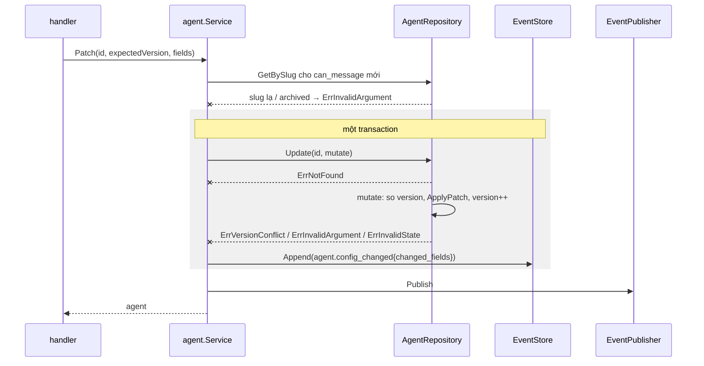
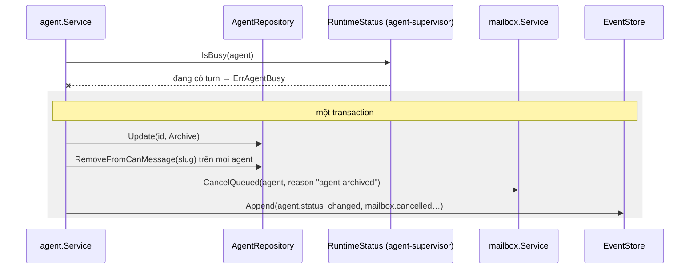
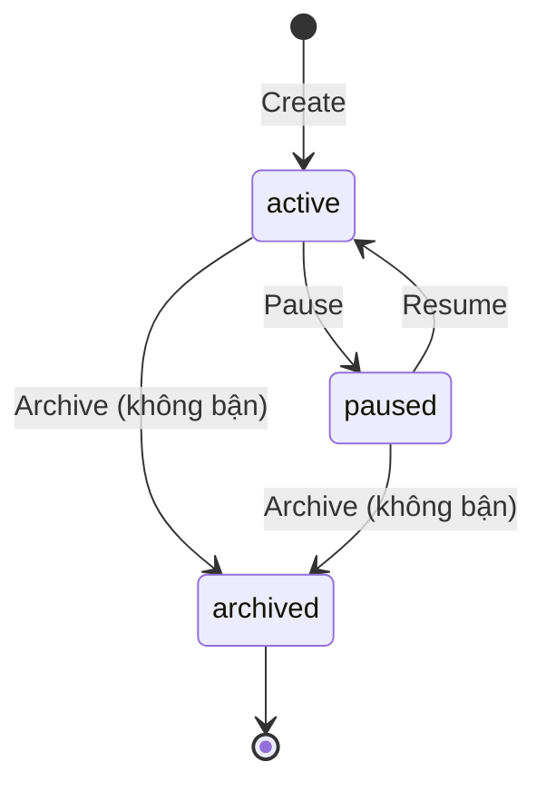

# Design — agent-registry

`domain.Agent` giữ invariant và state machine `active ⇄ paused → archived`; `domain.EffectivePolicy` gộp base policy với cấu hình. Use case `agent.Service` điều phối repository, event store và transaction. Handler chỉ decode và map lỗi.

## Constraints

| # | Constraint | How it is checked |
|---|---|---|
| 1 | Validate và state machine nằm trong domain | depguard + test domain |
| 2 | Base policy là hằng trong domain, dùng chung với agent-runtime `AskTools` | test `TestEffectivePolicyKeepsBase` |
| 3 | `Update` atomic, so `config_version` bên trong mutate | test `TestPatchVersionConflict` |
| 4 | Không log `system_prompt` | review |

## Field

| Field | Type | Rule | Default |
|---|---|---|---|
| `id` | uuid | sinh bởi server | |
| `slug` | string | `^[a-z][a-z0-9-]{1,31}$`, unique, bất biến | bắt buộc |
| `display_name` | string | 1…64 ký tự | bắt buộc |
| `model` | string | thuộc `ORCH_ALLOWED_MODELS` | bắt buộc |
| `system_prompt` | string | ≤ 16 KiB UTF-8; truyền bằng `--append-system-prompt`, không ghi vào `CLAUDE.md` | `""` |
| `allowed_tools` | []string | ≤ 64 rule, cú pháp `Tên` hoặc `Tên(pattern)` | `[]` |
| `disallowed_tools` | []string | như trên | `[]` |
| `skills` | []string | ≤ 32, mỗi tên `^[a-z0-9-]{1,64}$`; MVP chỉ lưu | `[]` |
| `max_turns_per_task` | int | 1…200 | 50 |
| `can_message` | []string | slug agent `active`/`paused`, không phải chính nó, ≤ 32 | `[]` |
| `mailbox_capacity` | int | 1…100 | 20 |
| `status` | enum | `active`, `paused`, `archived` | `active` |
| `config_version` | int | tăng 1 mỗi lần PATCH thành công | 1 |
| `created_at`, `updated_at` | time | UTC | |

`can_message` là danh sách agent **được phép hỏi agent này** (chiều nhận), dùng bởi [agent-mailbox](../agent-mailbox/design.md) để chặn `ask_agent`.

## Components

| Path | Component | Responsibility | Status |
|---|---|---|---|
| `internal/domain/agent.go` | `Agent`, `NewAgent`, `ApplyPatch`, `Pause`, `Resume`, `Archive` | invariant, state machine | new |
| `internal/domain/policy.go` | `BasePolicy`, `EffectivePolicy`, `ParseToolRule` | gộp quyền | new |
| `internal/usecase/port` | `AgentRepository` (`Create`, `Get`, `GetBySlug`, `List`, `Update`) | port | new |
| `internal/usecase/agent/service.go` | `Create`, `Get`, `List`, `Patch`, `Pause`, `Resume`, `Archive` | điều phối, event, gọi mailbox khi archive | new |
| `internal/adapter/repository/postgres/agent.go` | `AgentRepository` | bảng `agents` | new |
| `migrations/0000x_agents.sql` | bảng `agents`; đổi `approvals.agent_id` sang `uuid` FK | schema | new |
| `internal/delivery/httpapi/agents.go` | handlers | decode, map lỗi | new |
| `api/openapi.yaml` | `/agents…` | contract | modified |

## Flows

### Tạo

`POST /agents → handler decode → agent.Service.Create → domain.NewAgent (validate R-2, R-4, R-11) → repo.GetBySlug từng phần tử can_message (R-5) → WithinTx(repo.Create + EventStore.Append(agent.created)) → publish`. Unique violation trên `slug` → `ErrSlugTaken` → 409. Không có side effect ngoài DB.

### Sửa cấu hình

Step 1 — Kiểm `can_message` (`agent.Service`)
- Trigger: patch có `can_message`.
- Pre-condition: none.
- Call: `GetBySlug` cho từng slug.
    - Success → bước 2.
    - Failure (slug không tồn tại hoặc `archived`) → `ErrInvalidArgument` field `can_message`. Signal: none: caller nhận 400.
    - Grouped with: none. Agent bị archive giữa bước 1 và 2 được xử lý ở R-14 (archive gỡ slug khỏi mọi `can_message`).

Step 2 — Update atomic (`AgentRepository`)
- Trigger: bước 1.
- Pre-condition: agent tồn tại.
- Call: `Update(id, mutate)`; mutate so `expectedVersion`, gọi `ApplyPatch`, tăng version.
    - Success → bước 3.
    - Failure (không tồn tại) → `ErrNotFound`. Signal: none.
    - Failure (version khác) → `ErrVersionConflict`, không ghi. Signal: none.
    - Failure (agent `archived`) → `ErrInvalidState`. Signal: none.
    - Grouped with: transaction cùng bước 3.

Step 3 — Event (`EventStore`)
- Trigger: mutate thành công.
- Call: `Append(agent.config_changed{config_version, changed_fields})`.
    - Success → commit, publish. Signal: log INFO `agent config changed` + `agent_id`, `config_version`, `changed_fields`.
    - Failure (ghi lỗi) → rollback (event-schema R-6). Signal: log ERROR.
    - Grouped with: bước 2.

### Archive

Step 1 — Kiểm bận (other feature: [agent-supervisor](../agent-supervisor/design.md))
- Trigger: `DELETE /agents/{id}`.
- Call: `RuntimeStatus.IsBusy(agentID)` qua port.
    - Success (rảnh) → bước 2.
    - Failure (đang chạy turn) → 409 `agent_busy`. Signal: none.
    - Grouped with: none. Race với một delivery bắt đầu ngay sau bước 1 được chặn vì mailbox chỉ claim item của agent `active` (đọc trong cùng transaction claim).

Step 2 — Archive và dọn (`agent.Service`)
- Call: `Update(Archive)`, `RemoveFromCanMessage`, `mailbox.CancelQueued`, event.
    - Success → commit, publish; supervisor nhận `agent.status_changed` và đóng process idle.
    - Failure (lỗi DB) → rollback toàn bộ. Signal: log ERROR `agent archive failed`.
    - Grouped with: một transaction.

## State machine

| State | Allowed actions | Limits | Exit |
|---|---|---|---|
| `active` | Patch, Pause, Archive | — | `paused`, `archived` |
| `paused` | Patch, Resume, Archive | mailbox nhận nhưng không giao | `active`, `archived` |
| `archived` | GET | terminal | — |

## Error mapping

| Source error | Code | Result | Message key |
|---|---|---|---|
| `domain.ErrInvalidArgument` | `invalid_argument` | 400, kèm danh sách field | `agent.invalid` |
| `domain.ErrNotFound` | `not_found` | 404 | `agent.not_found` |
| `agent.ErrSlugTaken` | `slug_taken` | 409 | `agent.slug_taken` |
| `domain.ErrVersionConflict` | `version_conflict` | 409 | `agent.version_conflict` |
| `domain.ErrInvalidState` | `invalid_state` | 409 | `agent.invalid_state` |
| `agent.ErrAgentBusy` | `agent_busy` | 409 | `agent.busy` |
| khác | `internal` | 500 opaque | `common.internal` |

## Persistence

Bảng `agents`: các cột theo bảng Field; list dùng `text[]`; `slug` UNIQUE; CHECK cho `status`, giới hạn số. Migration cùng file đổi `approvals.agent_id` sang `uuid REFERENCES agents(id)` (bảng `approvals` rỗng hoặc chỉ có dữ liệu thử ở thời điểm này, A-1).

## Config

`ORCH_ALLOWED_MODELS` (mặc định `opus,sonnet,haiku`): mỗi phần tử khác rỗng; inject vào `agent.NewService` dưới dạng `[]string`.

## Test plan

| Test | Proves | Level | Location |
|---|---|---|---|
| `TestNewAgent_Valid`, `TestNewAgent_InvalidFields` | R-1, R-2, R-4, R-11 | B | `internal/domain/agent_test.go` |
| `TestCreateSlugTaken` | R-3 | B (integration) | `postgres/agent_test.go` |
| `TestCreateCanMessageValidation` | R-5 | B | `internal/usecase/agent/service_test.go` |
| `TestListOmitsPrompt`, `TestGetIncludesEffectivePolicy` | R-6, R-7 | B | `internal/delivery/httpapi/agents_test.go` |
| `TestPatchVersionConflict`, `TestPatchSlugImmutable`, `TestPatchEmitsChangedFields` | R-8 | B | use case + domain |
| (ở agent-supervisor) `TestRespawnOnConfigVersionChange` | R-9 | B | agent-supervisor |
| `TestEffectivePolicyKeepsBase` | R-10, SEC-2 | B | `internal/domain/policy_test.go` |
| `TestPauseResume`, `TestInvalidStateTransitions` | R-12, R-13, R-15 | B | domain + use case |
| `TestArchiveBusy`, `TestArchiveCancelsQueuedAndUnlinks` | R-14 | B | use case với fake runtime và fake mailbox |

Not automated: SEC-1 bằng review.

## Known gaps

- Không có lịch sử nội dung cấu hình (chỉ tên field đổi): TD-1.
