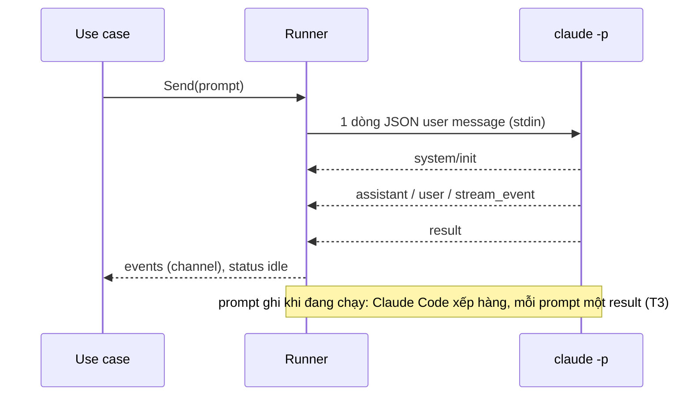
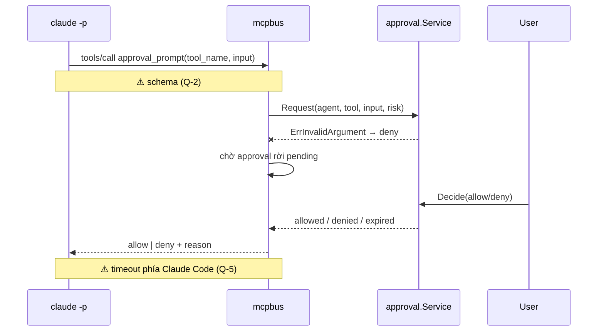
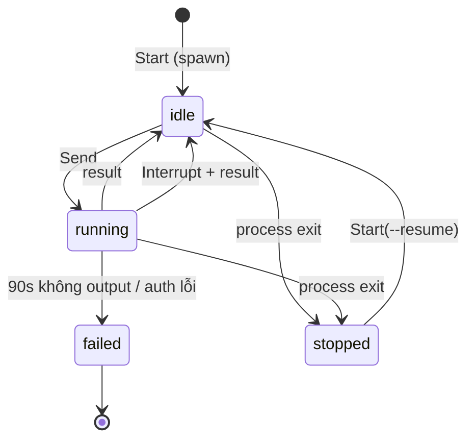

# Design — agent-runtime

Một `Runner` cho mỗi agent, sở hữu đúng một process `claude`: một goroutine ghi stdin, một goroutine đọc stdout thành event typed, một goroutine chờ process exit. Duyệt quyền đi qua MCP server HTTP trong cùng binary, gọi use case approval.

## Constraints

| # | Constraint | How it is checked |
|---|---|---|
| 1 | Runner là adapter, implement port `AgentRuntime`; use case không biết tới `os/exec` | depguard rule `usecase` |
| 2 | Chỉ dùng interface có docs: flags, stream-json, MCP, hooks. Không tự cài lại control protocol của SDK | review |
| 3 | Env con theo allowlist (R-2) | test `TestRunnerEnvAllowlist` |
| 4 | Không log nội dung prompt / tool (SEC-3) | review |
| 5 | Không goroutine leak khi process chết | test `-race` + `goleak` (A-2) |

## Components

| Path | Component | Responsibility | Status |
|---|---|---|---|
| `internal/usecase/port` | `AgentRuntime`, `RuntimeEvent` | port cho use case | not started (sau spike) |
| `internal/adapter/runtime/claudecli/protocol` | decoder stream-json, encoder user message | map dòng NDJSON → `Message`, giữ `Raw` | new |
| `internal/adapter/runtime/claudecli` | `Runner` | spawn, env allowlist, stdin/stdout, signal, close | new (spike-grade, TD-4) |
| `internal/delivery/mcpbus` | MCP HTTP server (go-sdk v1.8.0), tool `approval_prompt`, `send_message` | nối Claude Code vào approval-inbox; inbound adapter nên nằm ở delivery | new (`send_message` stub TD-3) |
| `internal/usecase/approval` | `AwaitDecision`, `Pending` | chờ approval rời pending, tự expire khi quá hạn | modified (poll TD-5) |
| `internal/domain` | `ClassifyRisk` | tool đọc là low, còn lại high (fail closed) | modified |
| `internal/adapter/runtime/claudecli/protocol/testdata` | NDJSON mẫu | golden test cho decoder; thay bằng mẫu thật sau T1–T15 | new |
| `cmd/spike` | `preflight`, `run`, `test` | kiểm môi trường, CLI thử tay, chạy T1–T15 và ghi `docs/spike-report.md` | new (chỉ cho spike) |

## Flows

### Gửi prompt và nhận stream

Step 1 — Ghi prompt (`Runner`)
- Trigger: use case gọi `Send`.
- Pre-condition: process sống (`idle` hoặc `running`).
- Call: encode user message envelope, ghi một dòng lên stdin.
    - Success → bước 2, agent `running`.
    - Failure (stdin đã đóng / broken pipe) → `ErrProcessExited`, agent `stopped`. Signal: log ERROR `agent stdin write failed` + `agent_id`.
    - Success (agent đang `running`) → vẫn ghi, `pending` tăng; agent về `idle` khi `pending` về 0.
    - Grouped with: none.

Step 2 — Đọc stream (`Runner` reader)
- Trigger: dòng mới trên stdout.
- Pre-condition: none.
- Call: decode NDJSON, map theo `type`/`subtype`.
    - Success → phát event typed, `result` thì agent `idle` và lưu `session_id`.
    - Failure (dòng không parse được) → event `unknown` giữ dòng thô. Signal: log WARN `unparsed stream line` + `agent_id`, độ dài dòng.
    - Failure (dòng vượt 16 MB) → event `unknown`, dòng bị cắt. Signal: log WARN `unparsed stream line` + số byte.
    - Failure (không có dòng nào 90s sau prompt) → agent `failed`, process bị terminate. Signal: log ERROR `agent failed` + reason.
    - Grouped with: thứ tự event giữ nguyên thứ tự dòng.

### Duyệt quyền

Step 1 — Nhận tool call (`mcpbus`)
- Trigger: Claude Code cần duyệt một tool.
- Pre-condition: request có bearer token khớp agent của path `/mcp/<agent_id>` (SEC-4, xác nhận ở T15).
- Call: `approval.Service.Request`.
    - Success → bước 2.
    - Failure (input không hợp lệ) → trả deny ngay. Signal: log WARN `approval request rejected` + `agent_id`, `tool`.
    - Failure (token sai, agent lạ hoặc đã unregister) → HTTP 401, tool không chạy. Signal: log WARN `mcp request rejected` + path.
    - Grouped with: none.

Step 2 — Chờ quyết định (`mcpbus`)
- Trigger: bước 1.
- Pre-condition: approval `pending`.
- Call: `approval.Service.AwaitDecision`: poll `Get` mỗi 250ms (TD-5), tự `Expire` khi quá deadline.
    - Success (`allowed`) → trả allow.
    - Success (`denied` / `expired`) → trả deny kèm reason.
    - Failure (MCP request bị hủy phía client) → trả deny, giữ approval cho sweeper expire. Signal: log INFO `approval wait cancelled`.
    - Grouped with: none.

### Hủy turn, crash, shutdown

`Interrupt → SIGINT → chờ result (≤ 10s, sau đó SIGTERM)`. `process exit → event agent_exited(code) → status stopped`. `Shutdown → đóng stdin → chờ ORCH_SHUTDOWN_TIMEOUT → SIGTERM`.

## State machine

Runner không có `starting`: Claude Code phát `system/init` ở đầu mỗi turn, không phải lúc spawn (T1, T9), nên spawn xong là `idle`.

| State | Allowed actions | Limits | Exit |
|---|---|---|---|
| `idle` | Send, Close | — | `running` / `stopped` |
| `running` | Send (xếp hàng), Interrupt, Close | 90s chờ output đầu tiên | `idle` khi `pending` = 0 / `stopped` / `failed` |
| `stopped` | Start mới với `--resume` | — | `idle` (Runner mới) |
| `failed` | none | terminal tới khi sửa auth | — |

## Error mapping

| Source error | Code | Result | Message key |
|---|---|---|---|
| `ErrProcessExited` | `agent_stopped` | 409 | `agent.stopped` |
| init timeout / auth lỗi | `agent_failed` | event + status `failed` | `agent.failed` |
| khác | `internal` | 500 | `common.internal` |

## Config and lifecycle

Biến mới dự kiến: `ORCH_CLAUDE_BIN` (path tới `claude`, mặc định tra PATH), `ORCH_AGENT_FIRST_EVENT_TIMEOUT` (90s). Spike đọc từ flag, chưa từ config. Readiness: MCP server listen được và `claude --version` chạy được.

## Test plan

| Test | Proves | Level | Location |
|---|---|---|---|
| `TestDecoderGolden` trên `testdata/*.ndjson` | R-5, R-6 | B | `claudecli` |
| `TestRunnerEnvAllowlist` | R-2 | B | `claudecli` |
| `TestRunnerStateMachine` (multi-turn, busy, garbage, interrupt, crash, kill, auth fail, silent, close) với binary test làm claude giả | R-3, R-4, R-6, R-7, R-12, R-13, R-14 | B | `claudecli` |
| `TestBuildArgs` (không `--bare`, có `--strict-mcp-config`, settings deny và ask) | R-1, R-9, SEC-2, SEC-5 | B | `claudecli` |
| `TestSendWhileRunningQueues` | R-8 | B | `claudecli` |
| `TestCheckNotBypassedCatchesUserRule` (dòng NDJSON thật từ T5) | SEC-5 | B | `cmd/spike` |
| `TestApprovalPrompt*`, `TestAuth*`, `TestTwoAgentsRoutedSeparately` | R-10, SEC-4 | B | `delivery/mcpbus` |
| `TestScenariosAgainstFake`: chạy T1–T15 qua harness thật với claude giả gọi MCP thật | wiring của spike, không phải hành vi Claude | B | `cmd/spike` |
| Spike T1–T15 với `claude` thật | R-1…R-15, SEC-1, SEC-2, SEC-4, SEC-5 | D | `docs/spike-report.md` |

## Deliberately stubbed

- `send_message` chỉ ghi nhận, chưa lưu hay chuyển tiếp: TD-3.
- Runner là spike-grade, chưa có port `AgentRuntime`: TD-4.
- Quota Max đọc bằng parse text của `/usage`: TD-6.
- `AwaitDecision` poll thay vì nhận notify: TD-5.
