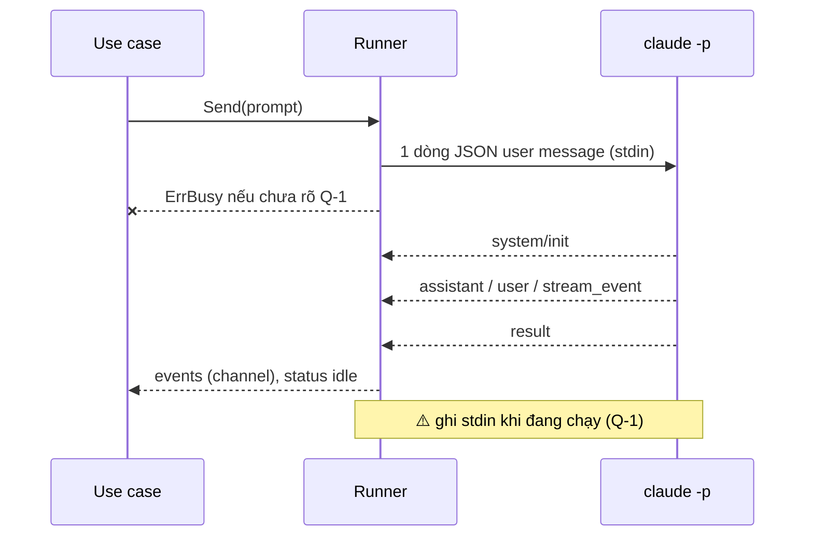
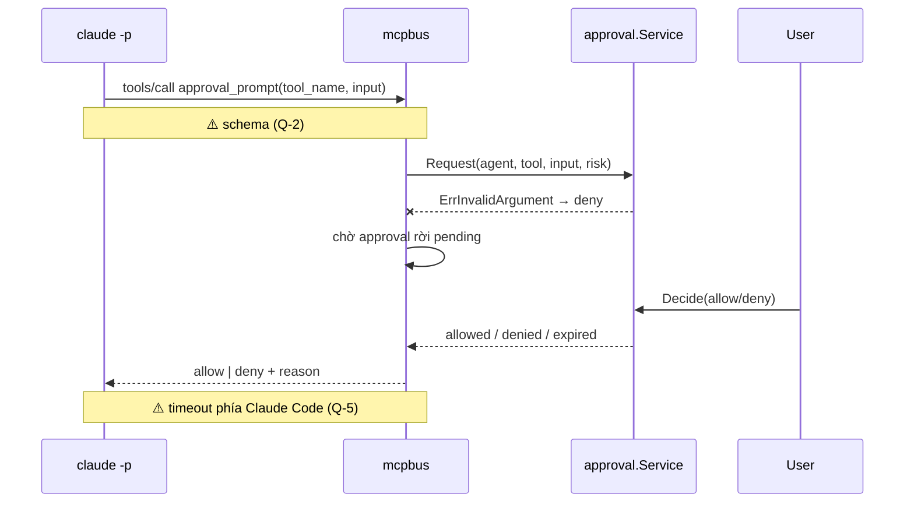
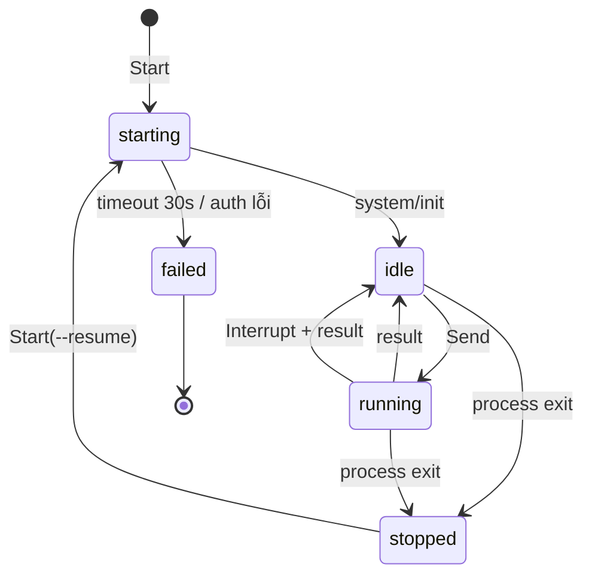

# Design — agent-runtime

Một `Runner` cho mỗi agent, sở hữu đúng một process `claude`: một goroutine ghi stdin, một goroutine đọc stdout thành event typed, một goroutine chờ process exit. Duyệt quyền đi qua MCP server HTTP trong cùng binary, gọi use case approval.

## Constraints

| # | Constraint | How it is checked |
|---|---|---|
| 1 | Runner là adapter, implement port `AgentRuntime`; use case không biết tới `os/exec` | depguard rule `usecase` |
| 2 | Chỉ dùng interface có docs: flags, stream-json, MCP, hooks. Không tự cài lại control protocol của SDK | review |
| 3 | Env con theo allowlist (R-2) | test `TestRunnerEnvAllowlist` |
| 4 | Không log nội dung prompt / tool (SEC-3) | review |
| 5 | Không goroutine leak khi process chết | test `-race` + `goleak` (A-2) |

## Components

| Path | Component | Responsibility | Status |
|---|---|---|---|
| `internal/usecase/port` | `AgentRuntime`, `RuntimeEvent` | port cho use case | new |
| `internal/adapter/runtime/claudecli` | `Runner`, decoder stream-json | spawn, stdin/stdout, signal, resume | stub (TD-1) |
| `internal/adapter/mcpbus` | MCP HTTP server, tool `approval_prompt` | nối Claude Code vào approval-inbox | stub (TD-2) |
| `internal/adapter/runtime/claudecli/testdata` | NDJSON thật từ spike | golden test cho decoder | new |
| `cmd/spike` | CLI thử tay | gõ prompt, in event | new (chỉ cho spike) |

## Flows

### Gửi prompt và nhận stream

Step 1 — Ghi prompt (`Runner`)
- Trigger: use case gọi `Send`.
- Pre-condition: process sống, agent `idle`.
- Call: encode user message envelope, ghi một dòng lên stdin.
    - Success → bước 2, agent `running`.
    - Failure (stdin đã đóng / broken pipe) → `ErrProcessExited`, agent `stopped`. Signal: log ERROR `agent stdin write failed` + `agent_id`.
    - Failure (agent đang `running`) → `ErrBusy` tới khi Q-1 được trả lời. Signal: none: caller nhận lỗi.
    - Grouped with: none.

Step 2 — Đọc stream (`Runner` reader)
- Trigger: dòng mới trên stdout.
- Pre-condition: none.
- Call: decode NDJSON, map theo `type`/`subtype`.
    - Success → phát event typed, `result` thì agent `idle` và lưu `session_id`.
    - Failure (dòng không parse được) → event `unknown` giữ dòng thô. Signal: log WARN `unparsed stream line` + `agent_id`, độ dài dòng.
    - Failure (dòng vượt 10 MB) → event `unknown` với cờ truncated. Signal: log WARN.
    - Grouped with: thứ tự event giữ nguyên thứ tự dòng.

### Duyệt quyền

Step 1 — Nhận tool call (`mcpbus`)
- Trigger: Claude Code cần duyệt một tool.
- Pre-condition: agent được định danh qua URL (Q-4).
- Call: `approval.Service.Request`.
    - Success → bước 2.
    - Failure (input không hợp lệ) → trả deny ngay. Signal: log WARN `approval request rejected` + `agent_id`, `tool`.
    - Failure (agent không định danh được) → trả deny. Signal: log WARN `unknown agent on mcp`.
    - Grouped with: none.

Step 2 — Chờ quyết định (`mcpbus`)
- Trigger: bước 1.
- Pre-condition: approval `pending`.
- Call: đợi notify từ use case hoặc poll `Get` cho tới khi terminal.
    - Success (`allowed`) → trả allow.
    - Success (`denied` / `expired`) → trả deny kèm reason.
    - Failure (MCP request bị hủy phía client) → giữ approval, sweeper sẽ cho expire. Signal: log INFO `approval wait cancelled`.
    - Grouped with: none.

### Hủy turn, crash, shutdown

`Interrupt → SIGINT → chờ result (≤ 10s, sau đó SIGTERM)`. `process exit → event agent_exited(code) → status stopped`. `Shutdown → đóng stdin → chờ ORCH_SHUTDOWN_TIMEOUT → SIGTERM`.

## State machine

| State | Allowed actions | Limits | Exit |
|---|---|---|---|
| `starting` | none | 30s chờ init | `idle` / `failed` |
| `idle` | Send, Stop | — | `running` / `stopped` |
| `running` | Interrupt, Stop | — | `idle` / `stopped` |
| `stopped` | Start (resume) | — | `starting` |
| `failed` | none | terminal tới khi sửa auth | — |

## Error mapping

| Source error | Code | Result | Message key |
|---|---|---|---|
| `ErrBusy` | `agent_busy` | 409 | `agent.busy` |
| `ErrProcessExited` | `agent_stopped` | 409 | `agent.stopped` |
| init timeout / auth lỗi | `agent_failed` | event + status `failed` | `agent.failed` |
| khác | `internal` | 500 | `common.internal` |

## Config and lifecycle

Biến mới dự kiến: `ORCH_CLAUDE_BIN` (path tới `claude`, mặc định tra PATH), `ORCH_AGENT_INIT_TIMEOUT` (30s). Readiness: MCP server listen được và `claude --version` chạy được.

## Test plan

| Test | Proves | Level | Location |
|---|---|---|---|
| `TestDecoderGolden` trên `testdata/*.ndjson` | R-5, R-6 | B | `claudecli` |
| `TestRunnerEnvAllowlist` | R-2 | B | `claudecli` |
| `TestRunnerStateMachine` với process giả (script echo NDJSON) | R-4, R-7, R-12, R-13 | B | `claudecli` |
| `TestApprovalPromptAllowDenyExpire` | R-10 | B | `mcpbus` |
| Spike T1–T15 | R-1…R-15, SEC-1, SEC-2 | C, D | `docs/spike-report.md` |

## Deliberately stubbed

- Runner chưa implement: TD-1.
- MCP server chưa implement: TD-2.
