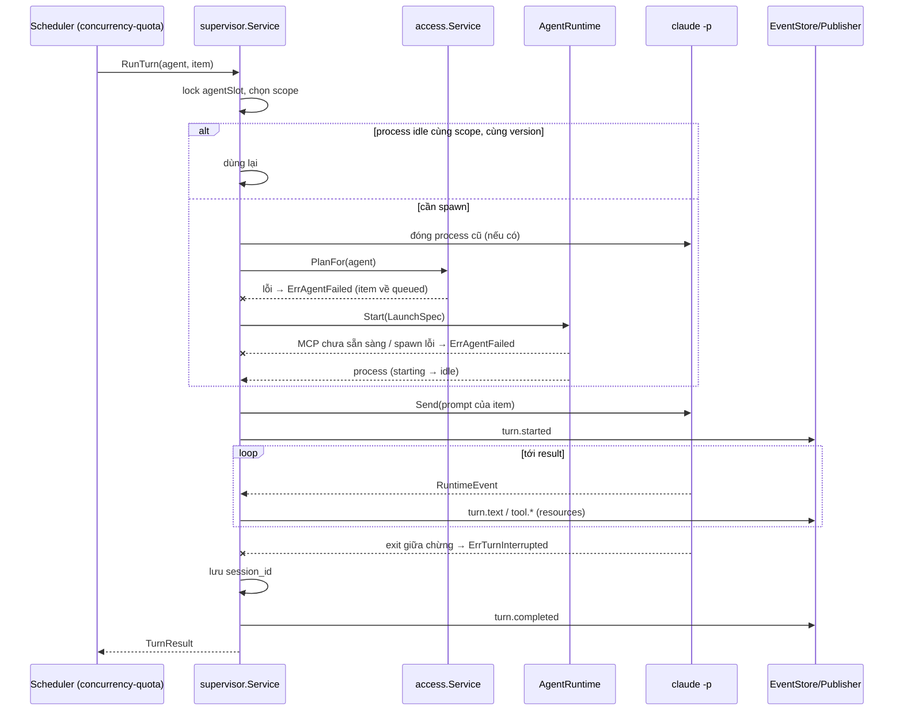
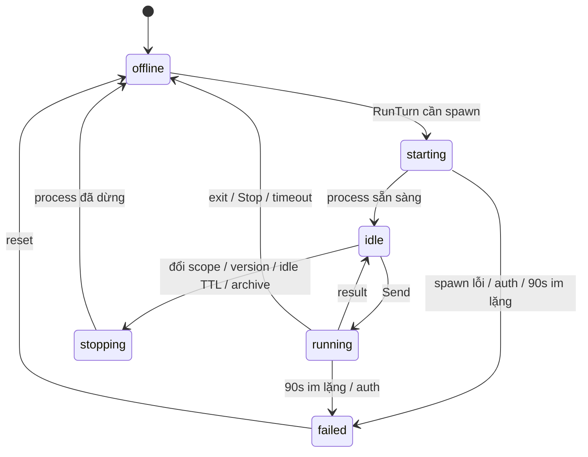

# Design — agent-supervisor

Use case `supervisor.Service` giữ một `agentSlot` cho mỗi agent (mutex + process hiện tại + scope + version lúc spawn). `RunTurn` là hàm đồng bộ: đảm bảo process, gửi prompt, đọc event tới `result`. Adapter `claudecli.Runner` (đã có từ spike) được bọc thành `port.AgentRuntime`. Dựng `LaunchSpec` là rule thuần trong domain để test bảng.

## Constraints

| # | Constraint | How it is checked |
|---|---|---|
| 1 | Use case không import `os/exec` hay `claudecli` | depguard `usecase` |
| 2 | Một agent chỉ có một process tại một thời điểm | `agentSlot` mutex; test `TestOneProcessPerAgent` (`-race`) |
| 3 | Một prompt mỗi lần trên đường scheduler (R-2) | test `TestRunTurnSerial` |
| 4 | Prompt và settings qua file `0600`, không argv (SEC-3) | test `TestLaunchSpecNoPromptInArgs` |
| 5 | `LaunchSpec` dựng thuần từ agent + plan + scope | depguard `domain`, test bảng |

## LaunchSpec

| Thành phần | Lấy từ | Flag / cách truyền |
|---|---|---|
| Binary | `ORCH_CLAUDE_BIN` | — |
| Chế độ | cố định | `-p --input-format stream-json --output-format stream-json --verbose` |
| `cwd` | scope | process working dir |
| Model | `agent.model` | `--model` |
| Prompt riêng | `agent.system_prompt` | `--append-system-prompt-file <tmp 0600>` (⚠️ A-2) |
| Quyền | `EffectivePolicy` + `AccessPlan` rules | `--settings <tmp 0600>` (allow / ask / deny, deny `.claude/**`, `crossSessionInbound: refuse`) |
| Thư mục thêm | `AccessPlan.add_dirs` | `--add-dir` |
| MCP | server `orch` (URL `/mcp/<agent_id>`, bearer mới) + entry nguồn từ `AccessPlan` | `--mcp-config <tmp 0600>`, `--strict-mcp-config` |
| Duyệt | cố định | `--permission-prompt-tool mcp__orch__approval_prompt` |
| Resume | `agent_sessions` | `--resume <session_id>` |
| Giới hạn | `agent.max_turns_per_task` | `--max-turns` ⚠️ Q-1 |
| Env | allowlist (agent-runtime R-2) | — |

> ⚠️ Not confirmed: `--max-turns` tính theo prompt hay theo process khi stdin giữ mở — chặn việc dùng flag này; tới khi có câu trả lời, supervisor đếm `num_turns` trong `result` và dừng process khi tổng của task vượt giới hạn (A-1). (Q-1)

## Chọn scope

| Item | Scope |
|---|---|
| `task`, `user` (có `task_id`) | worktree của task đó |
| `reply` | worktree của task nơi câu hỏi gốc phát ra (`task_id` của item reply) |
| `ask` (không có `task_id` của người nhận) | worktree của task gần nhất của người nhận còn `running`/`idle`; không có thì home của agent `<workspace_root>/_agents/<slug>` (A-3) |

Scope key = đường dẫn tuyệt đối của `cwd`. `agent_sessions(agent_id, scope_key) → session_id`.

## Components

| Path | Component | Responsibility | Status |
|---|---|---|---|
| `internal/domain/launch.go` | `LaunchSpec`, `BuildLaunchSpec(agent, plan, scope, session)` | rule dựng lệnh | new |
| `internal/domain/runtime.go` | `RuntimeState`, chuyển trạng thái hợp lệ | state machine | new |
| `internal/usecase/port` | `AgentRuntime`, `RuntimeProcess` (`Send`, `Events`, `Stop`, `Wait`), `RuntimeEvent`, `SessionRepository`, `AgentStopper`, `RuntimeStatus` | port | new (resolve agent-runtime#TD-4) |
| `internal/usecase/supervisor/service.go` | `RunTurn`, `Stop`, `StopForAccessChange`, `IsBusy`, `Reset`, idle reaper | vòng đời theo agent | new |
| `internal/usecase/supervisor/mapper.go` | `RuntimeEvent` → event-schema | gắn id, resources (`ClassifyResources`) | new |
| `internal/adapter/runtime/claudecli` | `Runner` bọc thành `AgentRuntime`; ghi file tạm `0600` | implement port | modified |
| `internal/adapter/repository/postgres/session.go` | `SessionRepository` | bảng `agent_sessions` | new |
| `internal/delivery/mcpbus` | cấp / thu hồi bearer theo spawn | modified |
| `internal/delivery/httpapi/runtime.go` | `GET /agents/{id}/runtime`, `POST …/reset` | new |

## Flows

### RunTurn

Step 1 — Khoá slot và chọn scope (`supervisor.Service`)
- Trigger: scheduler gọi `RunTurn`.
- Pre-condition: agent `active`, runtime không `failed`, scheduler đã cấp slot concurrency.
- Call: lock `agentSlot`; tính scope theo bảng Chọn scope (đọc task gần nhất qua `TaskReader` khi item là `ask`).
    - Success → bước 2.
    - Failure (agent `failed`) → `ErrAgentFailed` ngay. Signal: none: scheduler log.
    - Grouped with: lock giữ tới hết turn (R-2).

Step 2 — Đảm bảo process (`supervisor.Service`, `AgentRuntime`)
- Trigger: bước 1.
- Pre-condition: none.
- Call: so scope, `config_version`, `access_version` với process hiện tại; khác thì `Stop` (đóng stdin, chờ 10s, kill group), `PlanFor`, `BuildLaunchSpec`, `Start`.
    - Success → process `idle`, event `agent.runtime_changed{idle}`.
    - Failure (`PlanFor` lỗi) → `ErrAgentFailed`, không spawn. Signal: log ERROR `access plan failed`.
    - Failure (MCP server chưa sẵn sàng) → `ErrAgentFailed` (agent-runtime R-11). Signal: log ERROR `mcp not ready`.
    - Failure (spawn lỗi, binary thiếu) → agent `failed`. Signal: log ERROR `agent spawn failed` + `agent_id`, lỗi exec.
    - Grouped with: none.

Step 3 — Gửi prompt (`RuntimeProcess.Send`)
- Trigger: bước 2.
- Call: format prompt theo agent-mailbox (header + body), ghi một dòng stdin; event `turn.started`; agent `running`.
    - Success → bước 4.
    - Failure (broken pipe) → `ErrTurnInterrupted`, agent `offline`. Signal: log ERROR `agent stdin write failed`.
    - Grouped with: none.

Step 4 — Đọc tới `result` (`supervisor.Service`)
- Trigger: event từ process.
- Call: map và phát event; `tool_use` → `ClassifyResources`; lưu `session_id` khi thấy; dừng ở `result`.
    - Success → `turn.completed`, agent `idle`, trả `TurnResult`.
    - Failure (process thoát) → R-10. Signal: durable event `agent.exited`.
    - Failure (90s im lặng / auth fail) → R-11. Signal: event `agent.runtime_changed{failed, reason}`.
    - Failure (quá `ORCH_TURN_TIMEOUT`) → R-12. Signal: log WARN `turn timeout` + `agent_id`, `item_id`.
    - Grouped with: none; `session_id` ghi bằng upsert riêng, không chờ cuối turn.

### Dừng

`Stop(agent, reason)` → lấy process hiện tại (không chờ lock của turn) → `RuntimeProcess.Stop` (SIGTERM group, 3s, SIGKILL) → turn đang chờ nhận `ErrTurnInterrupted` → thu hồi bearer MCP → xoá file tạm → `agent.runtime_changed{offline, reason}`. Không có process thì không làm gì. Lỗi kill sau SIGKILL 5s → agent `failed`, log ERROR `agent stop failed`.

## State machine

| State | Allowed actions | Limits | Exit |
|---|---|---|---|
| `offline` | RunTurn | — | `starting` |
| `starting` | Stop | 90s | `idle`, `failed` |
| `idle` | RunTurn, Stop | `ORCH_AGENT_IDLE_TTL` | `running`, `stopping` |
| `running` | Stop | `ORCH_TURN_TIMEOUT`, 90s không output | `idle`, `offline`, `failed` |
| `stopping` | — | 10s + 3s + 5s | `offline`, `failed` |
| `failed` | Reset, GET | — | `offline` |

## Error mapping

| Source error | Code | Result | Message key |
|---|---|---|---|
| `supervisor.ErrTurnInterrupted` | — | scheduler giao lại item (mailbox) | — |
| `supervisor.ErrAgentFailed` | — | scheduler bỏ qua agent tới khi reset | — |
| `supervisor.ErrTurnTimeout` | — | item `failed` attempt (mailbox) | — |
| `domain.ErrNotFound` (HTTP) | `not_found` | 404 | `agent.not_found` |
| `domain.ErrInvalidState` (reset) | `invalid_state` | 409 | `agent.invalid_state` |
| khác | `internal` | 500 opaque | `common.internal` |

## Persistence

`agent_sessions(agent_id uuid FK, scope_key text, session_id text, updated_at timestamptz, PRIMARY KEY(agent_id, scope_key))`. Runtime state chỉ ở bộ nhớ và event (R-15).

## Config and lifecycle

| Name | Default | Validated |
|---|---|---|
| `ORCH_CLAUDE_BIN` | `claude` | tìm được trong `PATH` lúc khởi động, không thì exit 1 |
| `ORCH_AGENT_IDLE_TTL` | 10m | 1m…24h |
| `ORCH_TURN_TIMEOUT` | 60m | 1m…24h |

Shutdown: dừng scheduler trước, rồi đóng stdin mọi process, chờ `ORCH_SHUTDOWN_TIMEOUT`, SIGTERM phần còn lại (agent-runtime R-14).

## Test plan

| Test | Proves | Level | Location |
|---|---|---|---|
| `TestRunTurnSpawnsAndReturnsResult` | R-1, R-6 | B | `internal/usecase/supervisor` với fake `AgentRuntime` |
| `TestRunTurnSerial`, `TestOneProcessPerAgent` | R-2 | B (`-race`) | như trên |
| `TestBuildLaunchSpec`, `TestLaunchSpecNoPromptInArgs` | R-3, SEC-1, SEC-3 | B | `internal/domain/launch_test.go` |
| `TestSessionSavedAndResumed` | R-4 | B | use case + fake `SessionRepository` |
| `TestEventsMappedWithIDs` | R-5 | B | `supervisor/mapper_test.go` |
| `TestReuseIdleProcess`, `TestRespawnOnScopeOrVersionChange` | R-7, R-8 | B | use case |
| `TestIdleReaper` | R-9 | B | use case với fake clock |
| `TestExitDuringTurn` | R-10 | B | use case |
| `TestSilenceMarksFailed`, `TestAuthFailedMarksFailed` | R-11 | B | use case |
| `TestTurnTimeout` | R-12 | B | use case với fake clock |
| `TestStopKillsWithinDeadline` | R-13 | B | `claudecli` (claude giả, process group) |
| `TestPauseLetsTurnFinish`, `TestArchiveClosesIdle` | R-14 | B | use case |
| `TestStartAllOffline` | R-15 | B | use case |
| `TestRuntimeChangedEvents` | R-16 | B | use case |
| `TestRuntimeEndpoint`, `TestResetEndpoint` | R-17, R-18 | B | `httpapi` |
| `TestBearerRotatedPerSpawn` | SEC-2 | B | `mcpbus` |
| chạy 2 agent thật, giao 3 item, kill tay một process | R-1…R-10 | D | máy owner |

## Known gaps

- `--max-turns` chưa rõ ngữ nghĩa; đếm `num_turns` thay thế: TD-1.
