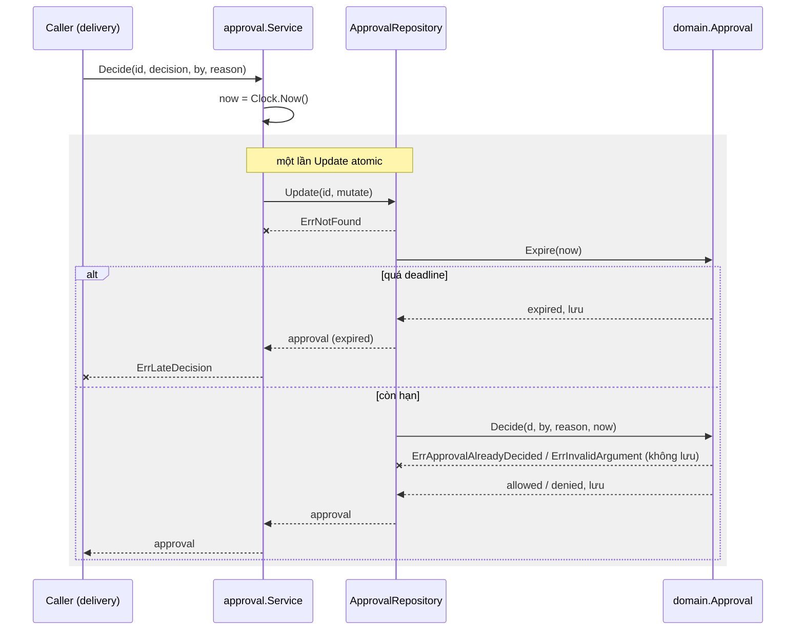
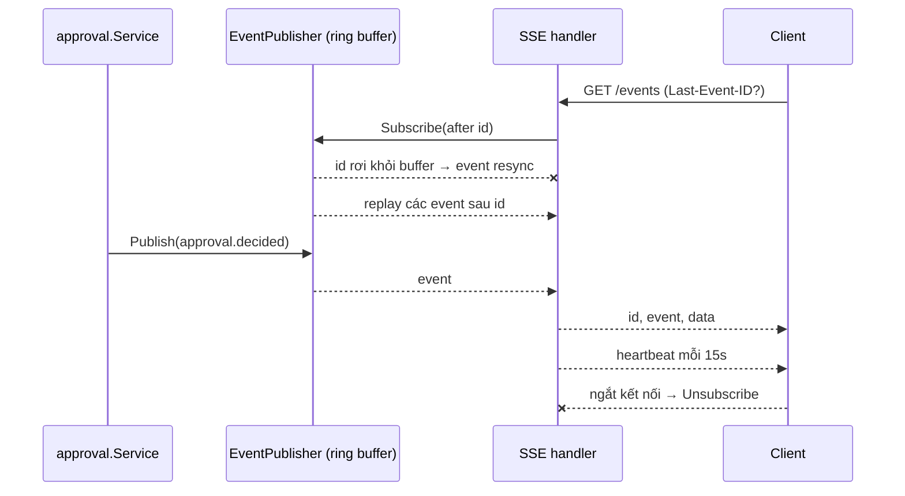
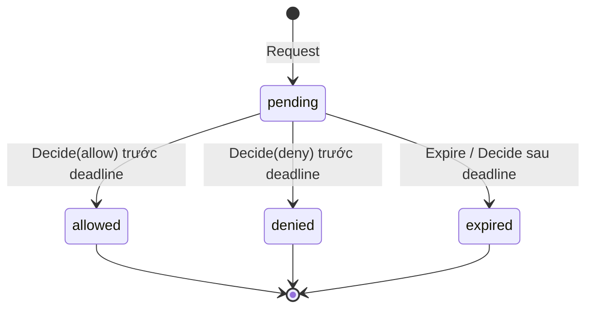

# Design — approval-inbox

Domain giữ toàn bộ rule chuyển trạng thái; use case chỉ điều phối repository, clock và id; repository bảo đảm read-modify-write atomic để hai quyết định đồng thời không cùng thắng.

## Constraints

| # | Constraint | How it is checked |
|---|---|---|
| 1 | Domain chỉ import stdlib | depguard rule `domain` (`make lint`) |
| 2 | Use case không import adapter, delivery, platform | depguard rule `usecase` |
| 3 | Timeout được inject vào use case, không đọc config trực tiếp | depguard rule `usecase` (cấm `internal/platform`) |
| 4 | Không log tool input (SEC-1) | review; field log chỉ có id/kind/tool/risk |
| 5 | Mọi trạng thái trừ `allowed` nghĩa là không được chạy | `Approval.IsAllowed`, test `TestExpire` |

## Components

| Path | Component | Responsibility | Status |
|---|---|---|---|
| `internal/domain/approval.go` | `Approval`, `NewApproval`, `Decide`, `Expire` | invariant + state machine | new |
| `internal/domain/errors.go` | sentinel errors | `ErrInvalidArgument`, `ErrNotFound`, `ErrApprovalAlreadyDecided`, `ErrApprovalExpired` | new |
| `internal/usecase/port/port.go` | `ApprovalRepository`, `Clock`, `IDGenerator` | port | new |
| `internal/usecase/approval/service.go` | `Service.Request`, `Decide`, `ExpireDue` | use case | new |
| `internal/adapter/repository/memory/approval.go` | in-memory repository | mutex, atomic `Update` | stub (TD-1) |
| `internal/adapter/system/system.go` | `Clock`, `UUIDGenerator` | UTC clock, UUIDv4 từ `crypto/rand` | new |
| `cmd/orchestrator/main.go` | sweeper goroutine | gọi `ExpireDue` mỗi 1s, dừng theo context | new |
| `api/openapi.yaml` | contract | shape REST + SSE event | new |
| `internal/delivery/httpapi` | `approvals` handlers | list, get, decide, map lỗi sang problem | new |
| `internal/delivery/httpapi` | `events` SSE handler | stream, heartbeat, `Last-Event-ID` | new |
| `internal/usecase/port` | `EventPublisher` | use case phát event khi approval đổi trạng thái | new |
| `internal/adapter/eventbus/memory` | ring buffer 1000 event + fan-out subscriber | implement `EventPublisher` | new |
| `internal/adapter/notify` | push adapter | Web Push / Telegram | ⚠️ chưa làm (Q-2) |

## Flows

### Request

`Service.Request → domain.NewApproval (validate, copy input, deadline) → ApprovalRepository.Create`. Một call, không side effect ngoài lưu; lỗi validate trả `ErrInvalidArgument`, trùng id trả `ErrAlreadyExists`.

### Decide

Step 1 — Lấy thời điểm (`approval.Service`)
- Trigger: caller gọi `Decide`.
- Pre-condition: none.
- Call: `Clock.Now()`; dùng một giá trị `now` cho cả bước 2 để kết quả nhất quán.
    - Success → bước 2.
    - Grouped with: none.

Step 2 — Update atomic (`ApprovalRepository`)
- Trigger: bước 1.
- Pre-condition: approval tồn tại.
- Call: `Update(id, mutate)`; repository giữ lock suốt mutate và chỉ lưu khi mutate trả nil.
    - Success → bước 3.
    - Failure (id không tồn tại) → `ErrNotFound`, không đổi gì. Signal: none: caller nhận lỗi.
    - Failure (context bị hủy) → `context.Canceled`, không đổi gì. Signal: none: caller nhận lỗi.
    - Grouped with: một Update cho cả kiểm deadline và quyết định, nên không có khoảng hở giữa đọc và ghi.

Step 3 — Áp rule (`domain.Approval`)
- Trigger: mutate trong bước 2.
- Pre-condition: bản copy mới nhất của approval.
- Call: `Expire(now)`; nếu không hết hạn thì `Decide(d, by, reason, now)`.
    - Success (hết hạn) → lưu `expired`, Service trả `ErrLateDecision`. Signal: log WARN `approval decided after deadline` + `approval_id`, `decided_by`.
    - Success (còn hạn) → lưu `allowed`/`denied`. Signal: log INFO `approval decided` + `approval_id`, `status`, `decided_by`.
    - Failure (đã quyết định) → `ErrApprovalAlreadyDecided`, không lưu. Signal: none: caller nhận lỗi.
    - Failure (thiếu người duyệt hoặc decision lạ) → `ErrInvalidArgument`, không lưu. Signal: none: caller nhận lỗi.
    - Grouped with: bước 2.

### Event SSE

Step 1 — Publish (`approval.Service`)
- Trigger: `Request`, `Decide`, `ExpireDue` lưu thành công.
- Pre-condition: bản ghi đã persist.
- Call: `EventPublisher.Publish(event)` sau khi Update thành công, không nằm trong mutate.
    - Success → bước 2.
    - Failure (publisher lỗi) → không rollback quyết định; client sẽ thấy khi gọi lại R-12. Signal: log WARN `event publish failed` + `approval_id`.
    - Grouped with: none, quyết định là nguồn sự thật, event chỉ là thông báo.

Step 2 — Fan-out (`eventbus/memory`)
- Trigger: Publish.
- Pre-condition: none.
- Call: gán id tăng dần, ghi vào ring buffer, gửi non-blocking cho mỗi subscriber.
    - Success → bước 3.
    - Failure (subscriber chậm, channel đầy) → ngắt subscriber đó; client reconnect với `Last-Event-ID`. Signal: log WARN `sse subscriber dropped`.
    - Grouped with: none.

Step 3 — Ghi SSE (`events` handler)
- Trigger: event tới channel của subscriber.
- Pre-condition: kết nối còn mở.
- Call: ghi `id:`, `event:`, `data:` rồi flush.
    - Success → chờ event tiếp.
    - Failure (client ngắt) → Unsubscribe, kết thúc handler. Signal: none: ngắt kết nối là bình thường.
    - Grouped with: none.

### Expire sweep

`sweeper (1s ticker) → Service.ExpireDue → ListPendingBefore(now) → Update(id, Expire) cho từng bản ghi`. Lỗi một bản ghi được gộp bằng `errors.Join`, vòng quét tiếp tục; `main` log ERROR. Dừng khi context bị hủy lúc shutdown.

## State machine

| State | Allowed actions | Limits | Exit |
|---|---|---|---|
| `pending` | Decide, Expire | deadline = created + timeout | `allowed` / `denied` / `expired` |
| `allowed` | none | terminal | agent được chạy |
| `denied` | none | terminal | agent nhận deny + reason |
| `expired` | none | terminal | agent nhận deny |

## Error mapping

| Source error | Code | Result (HTTP, khi có delivery) | Message key |
|---|---|---|---|
| `domain.ErrInvalidArgument` | `invalid_argument` | 400 | `approval.invalid` |
| `domain.ErrNotFound` | `not_found` | 404 | `approval.not_found` |
| `domain.ErrApprovalAlreadyDecided` | `already_decided` | 409 | `approval.already_decided` |
| `approval.ErrLateDecision` | `expired` | 409 | `approval.expired` |
| khác | `internal` | 500, body không chứa chi tiết | `common.internal` |

Body lỗi theo RFC 7807, `code` lấy từ cột Code. Không bao giờ đưa text lỗi nội bộ vào body.

## Layers

Theo bảng trong [`CLAUDE.md`](../../../../CLAUDE.md#architecture-rules). Chiều phụ thuộc được depguard enforce, đã thử import sai (domain → platform, usecase → adapter) và lint báo lỗi.

## Persistence

In-memory (TD-1). Khi chuyển SQLite: bảng `approvals`, `Update` dùng `BEGIN IMMEDIATE` hoặc `UPDATE ... WHERE id = ? AND status = 'pending'` để giữ R-7.

## Config and lifecycle

`ORCH_APPROVAL_TIMEOUT` đọc ở `internal/platform/config`, validate cùng các biến khác (báo mọi lỗi một lần), inject vào `approval.NewService`. Sweeper dừng trước khi process exit (`main` chờ `sweeperDone`).

## Observability

Log JSON (`slog`), field: `approval_id`, `agent_id`, `kind`, `tool`, `risk`, `deadline`, `status`, `decided_by`. Không bao giờ log `Input` (SEC-1).

## Test plan

| Test | Proves | Level | Location |
|---|---|---|---|
| `TestNewApproval_Valid` | R-1 | B | `internal/domain/approval_test.go` |
| `TestNewApproval_Invalid` | R-2 | B | `internal/domain/approval_test.go` |
| `TestNewApproval_CopiesInput` | R-3 | B | `internal/domain/approval_test.go` |
| `TestDecide`, `TestRequestThenAllow` | R-4, R-5, R-8 | B | domain + `internal/usecase/approval/service_test.go` |
| `TestLateDecisionIsDenied` | R-5 | B | `internal/usecase/approval/service_test.go` |
| `TestDecide_Twice` | R-6 | B | `internal/domain/approval_test.go` |
| `TestConcurrentDecisionsOnlyOneWins` | R-7 | B (`-race`) | `internal/usecase/approval/service_test.go` |
| `TestDecideUnknownID` | R-9 | B | `internal/usecase/approval/service_test.go` |
| `TestExpire`, `TestExpireDue` | R-10 | B | domain + use case |
| (chưa có) | R-11, SEC-1 | B | cần test fake repository lỗi |
| `TestListPendingApprovals` | R-12 | B | `internal/delivery/httpapi` |
| `TestGetApproval` | R-14 | B | `internal/delivery/httpapi` |
| `TestDecideHandlerStatusMapping` | R-15 | B | `internal/delivery/httpapi` |
| `TestSSEPublishAndReplay` | R-16, R-17, R-18 | B | `internal/delivery/httpapi` + `eventbus/memory` |
| curl `-N /events` trong lúc decide | R-16 | C | thủ công |
| (chờ Q-2) | R-13 | B | — |

Not automated: SEC-1 kiểm bằng review tới khi có test bắt log.

## Deliberately stubbed

- Repository in-memory, mất dữ liệu khi restart: TD-1.
- Audit log bất biến cho quyết định: TD-2.
- Chưa có xác thực client, chỉ dựa vào bind loopback: TD-3.
