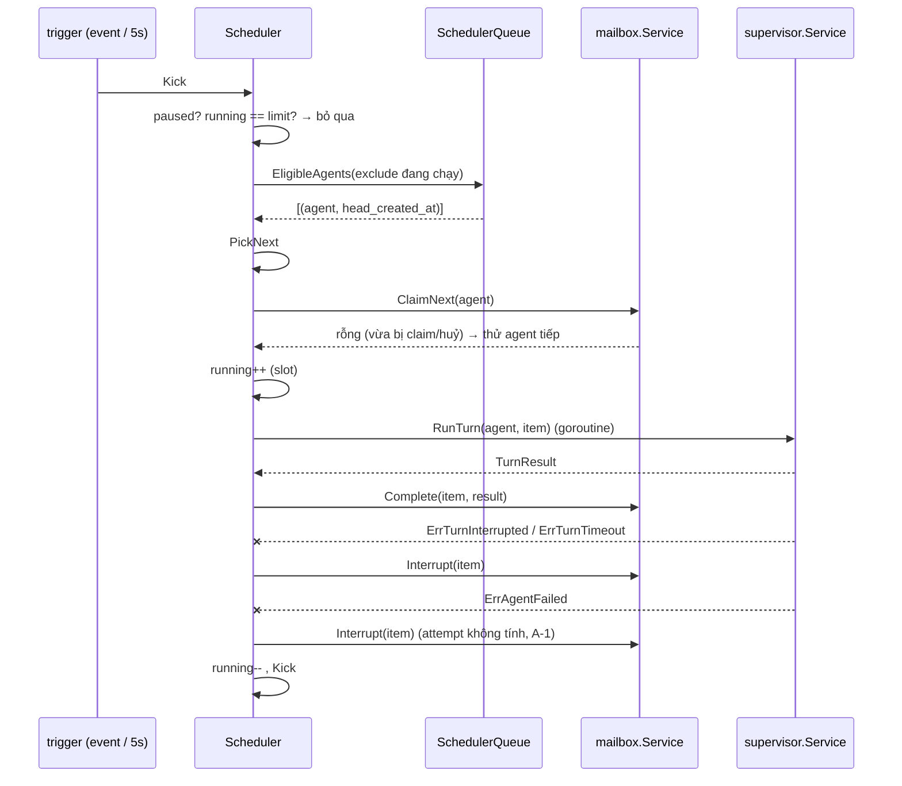
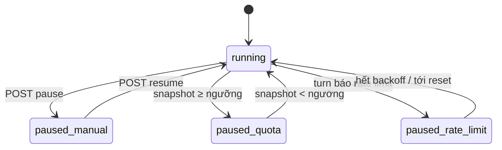

# Design — concurrency-quota

Một goroutine `Scheduler` (use case) giữ trạng thái trong bộ nhớ: số slot, tập agent đang chạy, cờ dừng (tay / quota / rate limit). Mỗi lần "tick" nó hỏi repository danh sách eligible agent sắp theo item đầu hàng, claim và chạy turn trong goroutine con. Quota poller là goroutine riêng, chạy `/usage` qua port `UsageProbe`; parser là hàm thuần trong domain.

## Constraints

| # | Constraint | How it is checked |
|---|---|---|
| 1 | Chỉ scheduler gọi `ClaimNext` | review; grep |
| 2 | Không vượt `ORCH_MAX_RUNNING` (R-1) | `TestNeverExceedsLimit` (`-race`, 100 item, 5 agent) |
| 3 | Parser `/usage` thuần, test theo mẫu text của version pin | depguard `domain`; `TestParseUsage` |
| 4 | Turn đang chạy không bị dừng khi pause | `TestPauseLetsRunningFinish` |

## Components

| Path | Component | Responsibility | Status |
|---|---|---|---|
| `internal/domain/quota.go` | `QuotaSnapshot`, `ParseUsage(text)`, `ShouldPause(snapshot, pct)` | rule | new |
| `internal/domain/scheduler.go` | `PickNext(candidates)` | chọn công bằng | new |
| `internal/usecase/port` | `UsageProbe`, `SchedulerQueue` (`EligibleAgents(ctx, exclude)`) | port | new |
| `internal/usecase/scheduler/service.go` | `Run(ctx)`, `Kick()`, `Pause`, `Resume`, `Status`, poller | vòng lặp | new |
| `internal/adapter/runtime/claudecli/usage.go` | `UsageProbe` | `claude -p "/usage"` timeout 60s | new |
| `internal/adapter/repository/postgres/mailbox.go` | `EligibleAgents` | query đầu hàng theo agent | modified |
| `internal/delivery/httpapi/scheduler.go` | handlers | | new |

## Flows

### Tick

Step 1 — Kiểm điều kiện (`Scheduler`)
- Trigger: `Kick` từ subscriber event (`mailbox.enqueued`, `agent.status_changed`, `agent.runtime_changed`, `scheduler.changed`), kết thúc turn, ticker 5s.
- Call: đọc cờ dừng và số slot dưới mutex.
    - Success (có slot, không dừng) → bước 2.
    - Success (không) → chờ trigger sau.
    - Grouped with: none.

Step 2 — Chọn agent (`SchedulerQueue`, `domain.PickNext`)
- Call: `EligibleAgents` (agent `active`, có item `queued`, không trong tập đang chạy, runtime không `failed` theo `RuntimeStatus`), sắp theo `created_at` item đầu hàng.
    - Success → bước 3.
    - Failure (DB lỗi) → log ERROR `scheduler query failed`, chờ tick sau.
    - Grouped with: none.

Step 3 — Claim (other feature: [agent-mailbox](../agent-mailbox/design.md#giao-và-hoàn-tất))
    - Success → bước 4.
    - Success (rỗng) → thử agent kế tiếp trong danh sách.
    - Grouped with: transaction của mailbox.

Step 4 — Chạy và kết thúc (other feature: [agent-supervisor](../agent-supervisor/design.md#runturn))
- Call: goroutine `RunTurn`; theo kết quả gọi `Complete` hoặc `Interrupt`; trả slot; `Kick`.
    - Failure (`Complete` lỗi DB) → log ERROR, thử `Interrupt` sau 5s (agent-mailbox bước 3).
    - Failure (lỗi rate limit trong `TurnResult`) → R-8: đặt cờ `rate_limited` tới `now + backoff`. Signal: event `scheduler.changed{paused, rate_limited}`.
    - Grouped with: none.

### Quota poll

`ticker ORCH_QUOTA_POLL → UsageProbe.Run (claude -p "/usage", cwd = <data_dir>/quota, timeout 60s) → domain.ParseUsage → event quota.updated → ShouldPause → set/clear cờ quota → event scheduler.changed nếu đổi`. Probe lỗi hoặc parse lỗi → `quota.updated{status: unknown}`, không đổi cờ (R-7). Probe không chiếm slot (A-3).

## State machine

Cờ dừng độc lập; scheduler giao việc khi không cờ nào bật. Dừng tay chỉ gỡ được bằng resume tay.

## Error mapping

| Source error | Code | Result | Message key |
|---|---|---|---|
| resume khi không dừng tay | `invalid_state` | 409 | `scheduler.invalid_state` |
| khác | `internal` | 500 opaque | `common.internal` |

## Config

| Name | Default | Validated |
|---|---|---|
| `ORCH_MAX_RUNNING` | 2 | 1…8 |
| `ORCH_QUOTA_POLL` | 5m | 1m…1h; `0` tắt poll |
| `ORCH_QUOTA_PAUSE_PCT` | 90 | 50…100 |
| `ORCH_RATE_LIMIT_BACKOFF` | 5m | 1m…1h |

## Test plan

| Test | Proves | Level | Location |
|---|---|---|---|
| `TestNeverExceedsLimit` | R-1 | B (`-race`) | `internal/usecase/scheduler` với fake mailbox, fake supervisor |
| `TestPickNextOldestHead` | R-2 | B | `internal/domain/scheduler_test.go` |
| `TestKickTriggers` | R-3 | B | use case |
| `TestCompleteOrInterruptBySupervisorResult`, `TestFailedAgentSkipped` | R-4 | B | use case |
| `TestParseUsage` (mẫu text từ spike T11) | R-5, R-7 | B | `internal/domain/quota_test.go` |
| `TestQuotaPauseAndAutoResume`, `TestPauseLetsRunningFinish` | R-6 | B | use case + fake probe |
| `TestRateLimitBackoff` | R-8 | B | use case — blocked by Q-1 |
| `TestManualPauseNotClearedByQuota` | R-9 | B | use case |
| `TestSchedulerEndpoint` | R-10 | B | `httpapi` |
| `TestShutdownStopsClaimingFirst` | R-11 | B | use case |
| chạy 3 agent với limit 2 trên máy owner, đọc `/scheduler` | R-1…R-5 | D | máy owner |

## Known gaps

- Quota dựa vào parse text `/usage`: agent-runtime#TD-6.
- Tín hiệu rate limit chưa biết (Q-1): TD-1.
