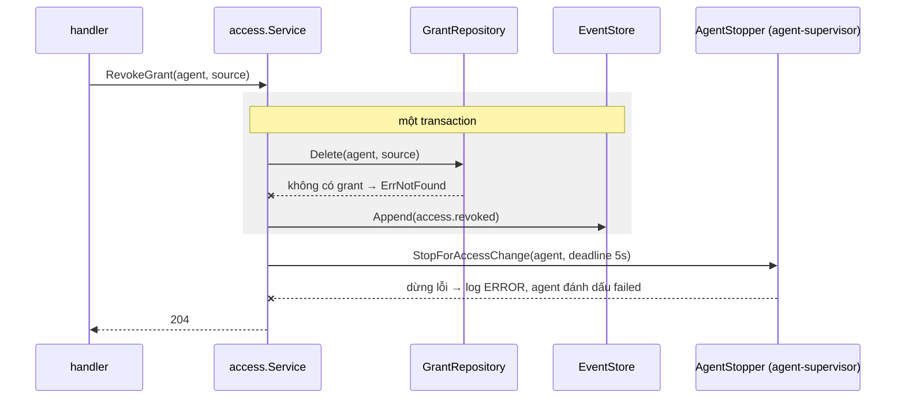
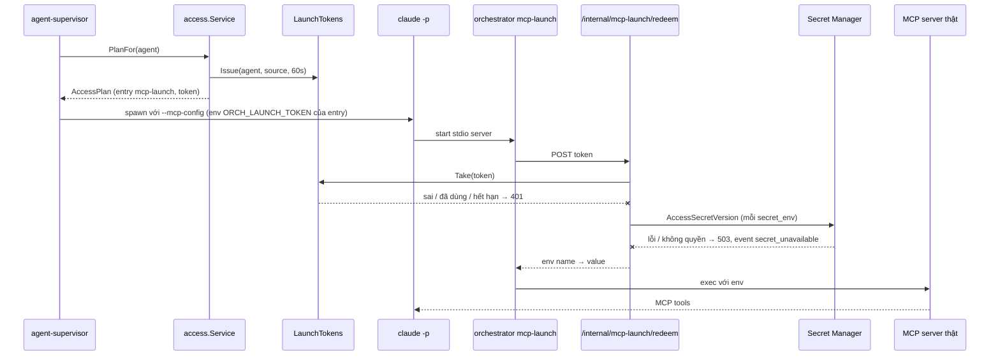

# Design — data-access

Rule cấp quyền nằm trong domain (`Source`, `Grant`, `BuildAccessPlan`), thuần, test bảng được. Use case `access.Service` lưu source/grant, phát event, gọi `port.AgentStopper` khi thu hồi. Secret đi đường riêng: supervisor chỉ nhận launch token; wrapper `mcp-launch` đổi token lấy secret qua loopback rồi `exec` server thật, nên secret không đi qua `claude`.

## Constraints

| # | Constraint | How it is checked |
|---|---|---|
| 1 | `BuildAccessPlan` thuần, không I/O | depguard `domain`; test bảng |
| 2 | Không giá trị secret trong `AccessPlan`, event, log (SEC-1) | test `TestAccessPlanHasNoSecretValues`; review log |
| 3 | Secret Manager chỉ gọi qua `port.SecretResolver` | depguard `usecase` |
| 4 | Thu hồi luôn dừng process (R-11) | test `TestRevokeStopsAgent` |
| 5 | Token so sánh thời gian hằng, dùng một lần | test `TestLaunchTokenSingleUse`, `crypto/subtle` |

## Components

| Path | Component | Responsibility | Status |
|---|---|---|---|
| `internal/domain/source.go` | `Source`, `NewSource`, validate theo kind, `DeniedPaths` | invariant nguồn | new |
| `internal/domain/grant.go` | `Grant`, `BuildAccessPlan(agent, grants, sources)` | ánh xạ grant → plan | new |
| `internal/usecase/port` | `SourceRepository`, `GrantRepository`, `SecretResolver`, `LaunchTokens`, `AgentStopper`, `PathInspector` | port | new |
| `internal/usecase/access/service.go` | CRUD source, Put/Delete grant, `PlanFor(agent)`, `IssueLaunch`, `Redeem` | điều phối | new |
| `internal/adapter/repository/postgres/access.go` | repo source, grant | bảng `data_sources`, `agent_grants` | new |
| `internal/adapter/secrets/gcpsm` | `SecretResolver` | `AccessSecretVersion` với ADC, timeout 5s | new |
| `internal/adapter/system/pathinspector.go` | `PathInspector` | `filepath.EvalSymlinks`, `os.Stat`, home dir | new |
| `internal/adapter/launchtoken/memory` | `LaunchTokens` | map token → (agent, source, expiry), xoá khi dùng | new |
| `internal/delivery/httpapi/access.go` | handlers public + `/internal/mcp-launch/redeem` | decode, map lỗi | new |
| `cmd/orchestrator` subcommand `mcp-launch` | wrapper | đọc `ORCH_LAUNCH_TOKEN`, redeem, `syscall.Exec` | new |

## Ánh xạ grant → AccessPlan

| Source kind | Mode | AccessPlan |
|---|---|---|
| `dir` | `read` | `--add-dir <path>`; allow `Read(/<path>/**)`, `Glob`, `Grep` trong path; deny `Edit(/<path>/**)`, `Write(/<path>/**)` |
| `dir` | `write` | như `read` nhưng không deny `Edit`/`Write`; `Edit`/`Write` vẫn ask theo base policy (R-9) |
| `mcp` | `read`/`write` | entry `src_<name>` trong `--mcp-config` (lệnh thật nếu không có secret, `mcp-launch` nếu có); allow `mcp__src_<name>__<tool>` cho tool trong grant không thuộc `write_tools`; ask cho tool trong grant thuộc `write_tools` (chỉ khi mode `write`, mode `read` thì deny); deny mọi tool còn lại của `spec.tools` |
| `web` | `read` | allow `WebFetch(domain:<d>)` cho mỗi domain (⚠️ Q-1) |
| `web` | `write` | không hợp lệ, 400 |

> ⚠️ Not confirmed: rule `allow` theo domain có thắng `ask` chung của `WebFetch` không — chặn đúng hành vi của `web` grant. (Q-1)
> ⚠️ Not confirmed: rule đường dẫn cho thư mục `--add-dir` hoạt động ở `-p` như interactive — chặn `dir` grant. (Q-2)

Hai câu được kiểm bằng hai case spike mới (T16, T17) trước khi implement Phase 3; tới lúc đó `web` và `dir` grant chỉ lưu, không đưa vào plan (A-1, A-2).

## Flows

### Thu hồi grant

Step 1 — Xoá grant (`access.Service`)
- Trigger: `DELETE /agents/{id}/grants/{source}`, hoặc sửa / xoá source (R-5) lặp cho từng agent.
- Pre-condition: none.
- Call: `GrantRepository.Delete` + `EventStore.Append(access.revoked)`.
    - Success → commit, bước 2.
    - Failure (không có grant) → 404. Signal: none.
    - Grouped with: một transaction.

Step 2 — Dừng agent (other feature: [agent-supervisor](../agent-supervisor/design.md))
- Trigger: bước 1 commit.
- Pre-condition: none.
- Call: `AgentStopper.StopForAccessChange(agentID)`: kill process group như huỷ turn (agent-runtime R-12); item đang giao trở lại `queued` (agent-mailbox R-16).
    - Success → agent `offline`; lần giao sau spawn với plan mới.
    - Failure (process không dừng trong 5s sau SIGKILL) → agent `failed`, không giao item mới. Signal: log ERROR `agent stop after revoke failed` + `agent_id`.
    - Grouped with: none; grant đã xoá nên mọi lần spawn sau đều dùng plan mới dù bước này lỗi.

### Spawn với nguồn MCP có secret

Step 1 — Lập plan và token (`access.Service`)
- Trigger: supervisor chuẩn bị spawn.
- Pre-condition: agent `active`.
- Call: `PlanFor(agent)` → `BuildAccessPlan`; với mỗi nguồn `mcp` có `secret_env`, `LaunchTokens.Issue` (256 bit từ `crypto/rand`, TTL 60s).
    - Success → plan cho supervisor.
    - Failure (repo lỗi) → supervisor không spawn, item quay lại `queued`. Signal: log ERROR `access plan failed` + `agent_id`.
    - Grouped with: none.

Step 2 — Redeem (`/internal/mcp-launch/redeem` → `access.Service.Redeem`)
- Trigger: `mcp-launch` khởi động trong cây process của `claude`.
- Pre-condition: request từ loopback.
- Call: `LaunchTokens.Take(token)` (xoá ngay), rồi `SecretResolver.Resolve(name)` cho từng biến, timeout 5s mỗi secret.
    - Success → 200 map env (body không log).
    - Failure (token không hợp lệ) → 401. Signal: log WARN `launch token rejected` + `source_id` nếu biết.
    - Failure (Secret Manager lỗi hoặc thiếu quyền) → 503. Signal: log ERROR `secret unavailable` + `source_id`, tên secret (không giá trị); durable event `access.source_changed{status: secret_unavailable}`.
    - Grouped with: none.

Step 3 — Exec (`mcp-launch`)
- Trigger: redeem thành công.
- Call: xoá `ORCH_LAUNCH_TOKEN` khỏi env, thêm env secret, `syscall.Exec(spec.command, spec.args)`.
    - Success → server thật thay thế process, nói stdio với `claude`.
    - Failure (exec lỗi) → exit 78. Signal: stderr một dòng không chứa secret.
    - Grouped with: none.

## Error mapping

| Source error | Code | Result | Message key |
|---|---|---|---|
| `domain.ErrInvalidArgument` | `invalid_argument` | 400 + field | `access.invalid` |
| path bị cấm (R-2) | `path_denied` | 400 | `access.path_denied` |
| `domain.ErrNotFound` | `not_found` | 404 | `access.not_found` |
| name trùng | `name_taken` | 409 | `access.name_taken` |
| tool trong grant không thuộc `spec.tools` | `invalid_argument` | 400 | `access.invalid_tools` |
| token không hợp lệ | — | 401 (internal) | — |
| secret không lấy được | — | 503 (internal) | — |
| khác | `internal` | 500 opaque | `common.internal` |

## Persistence

`data_sources(id uuid PK, name text UNIQUE, kind text CHECK, spec jsonb, status text, created_at, updated_at)` — `spec.secret_env` chỉ chứa tên tài nguyên. `agent_grants(agent_id uuid FK, source_id uuid FK ON DELETE CASCADE, mode text CHECK, tools text[], created_at, PRIMARY KEY(agent_id, source_id))`. Launch token chỉ ở bộ nhớ.

## Test plan

| Test | Proves | Level | Location |
|---|---|---|---|
| `TestNewSource_ByKind` | R-1, R-3, R-4 | B | `internal/domain/source_test.go` |
| `TestDirSourceDeniedPaths` (gồm symlink trỏ vào `~/.ssh`) | R-2 | B | use case với fake `PathInspector` |
| `TestUpdateSourceRevokesAgents` | R-5 | B | `internal/usecase/access` |
| `TestPutGrantAppliesNextSpawn` | R-6 | B | use case |
| `TestGetAccessHasNoSecretValues` | R-7, SEC-1 | B | `internal/delivery/httpapi/access_test.go` |
| `TestBuildAccessPlan` (bảng ánh xạ) | R-8, R-9, R-10 | B | `internal/domain/grant_test.go` |
| `TestRevokeStopsAgent` | R-11 | B | use case với fake `AgentStopper` |
| `TestLaunchTokenSingleUse`, `TestLaunchTokenExpiry` | R-12, SEC-4 | B | `adapter/launchtoken/memory` |
| `TestRedeemFailClosed` | R-13, SEC-3 | B | use case với fake `SecretResolver` |
| `TestMcpLaunchExecsWithEnv` | R-13 | B | `cmd/orchestrator` (helper process) |
| spike T16, T17 | Q-1, Q-2 | D | máy owner |
| chạy agent với nguồn MCP Postgres thật, `ps` thấy env chỉ ở server | R-12…R-14, SEC-1 | D | máy owner |
| `TestToolRequestedSourceStore` | R-15 | B | event-schema `TestClassifyResources` |

Not automated: SEC-2 (IAM) là bước setup của owner.

## Deliberately stubbed

- Không có sandbox OS cho `Bash`: TD-1.
- Không hỗ trợ MCP HTTP có secret: TD-2.
