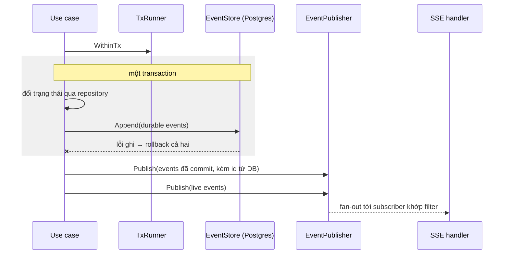
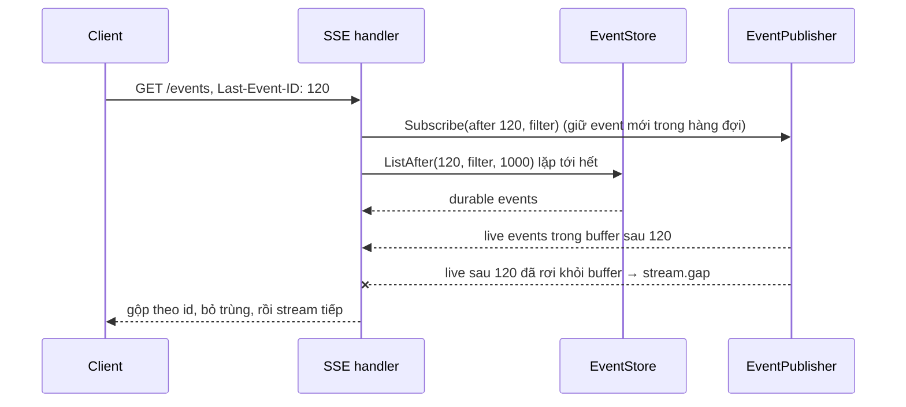

# Design — event-schema

Envelope và rule phân loại resource là domain thuần; use case ghi durable event qua `EventStore` trong transaction của chính nó (outbox trong cùng DB), rồi `EventPublisher` fan-out sau commit. SSE handler chỉ đọc từ publisher và store.

## Constraints

| # | Constraint | How it is checked |
|---|---|---|
| 1 | `domain.Event`, `domain.Resource`, `ClassifyResources` chỉ import stdlib | depguard rule `domain` |
| 2 | Durable event ghi cùng transaction với thay đổi trạng thái (R-5) | test `TestDurableEventRollsBackWithState` (integration) |
| 3 | Live event không vào Postgres, không vào log (R-4, SEC-1) | test `TestLiveEventNotStored`; review field log |
| 4 | `target` không chứa lệnh hay giá trị input (R-10) | test bảng `TestClassifyResources` có case lệnh chứa token giả |
| 5 | Payload theo JSON Schema | test `TestEventsMatchSchema` validate mọi type mẫu |

## Components

| Path | Component | Responsibility | Status |
|---|---|---|---|
| `api/events/v0.schema.json` | JSON Schema | envelope + payload từng type | new |
| `internal/domain/event.go` | `Event`, `EventType` constants, `NewEvent` | envelope, danh mục type, cờ durable | new |
| `internal/domain/resource.go` | `Resource`, `ClassifyResources(tool, input, worktree)` | suy ra resource từ tool call | new |
| `internal/usecase/port` | `EventStore` (`Append(ctx, ...Event)`, `ListAfter(ctx, id, filter, limit)`), `EventPublisher` (`Publish`, `Subscribe(after, filter)`) | port | new |
| `internal/adapter/repository/postgres/events.go` | `EventStore` trên bảng `events` | append trong tx của ctx, đọc theo id | new |
| `internal/adapter/eventbus/memory` | ring buffer + fan-out | id allocation cho live event, subscriber có hàng đợi 256 | new (thay bản trong approval-inbox Phase 4) |
| `internal/delivery/httpapi/events.go` | SSE handler | filter, `Last-Event-ID`, heartbeat, `stream.gap` | new |

## Danh mục type

| Type | Durable | Phát bởi | Payload chính |
|---|---|---|---|
| `agent.created`, `agent.config_changed`, `agent.status_changed` | yes | agent-registry | `slug`, `config_version`, `changed_fields` (tên field), `status` |
| `agent.runtime_changed` | yes | agent-supervisor | `state` (`offline/starting/idle/running/stopping/failed`), `reason` |
| `agent.exited` | yes | agent-supervisor | `exit_code`, `signal` |
| `turn.started` | yes | agent-supervisor | `delivery_id` (mailbox item) |
| `turn.completed` | yes | agent-supervisor | `delivery_id`, `is_error`, `subtype`, `duration_ms`, `cost_usd`, `usage` |
| `turn.text` | no | agent-supervisor | `text` (delta hoặc block) |
| `tool.requested` | yes | agent-supervisor | `tool_name`, `tool_use_id`, `resources` |
| `tool.input` | no | agent-supervisor | `tool_use_id`, `input` |
| `tool.completed` | yes | agent-supervisor | `tool_use_id`, `is_error` |
| `tool.output` | no | agent-supervisor | `tool_use_id`, `output` (cắt 64 KiB) |
| `approval.requested`, `approval.decided`, `approval.expired` | yes | approval-inbox | như approval-inbox R-12 + `status` |
| `mailbox.enqueued`, `.delivered`, `.done`, `.replied`, `.rejected`, `.expired`, `.failed`, `.cancelled` | yes | agent-mailbox | `item_id`, `kind`, `from`, `to`, `hop`, `body_len`, `reason` |
| `task.created`, `task.status_changed` | yes | task-dispatch | `title`, `status`, `worktree` |
| `access.source_changed`, `access.granted`, `access.revoked` | yes | data-access | `source`, `kind`, `mode`, `tools` |
| `project.status_changed`, `worktree.created` | yes | workspace | `project`, `status`, `name`, `path` |
| `scheduler.changed`, `quota.updated` | yes | concurrency-quota | `running`, `limit`, `paused`, `reason`, `session_pct`, `week_pct` |
| `stream.unknown` | no | agent-supervisor | `line_len` |
| `stream.gap` | no | SSE handler | `from_id` |

## Flows

### Ghi và phát event

Step 1 — Ghi durable event (use case phát event, `EventStore`)
- Trigger: use case lưu một thay đổi trạng thái.
- Pre-condition: đang trong transaction của `TxRunner` ([storage](../storage/design.md)).
- Call: `EventStore.Append(ctx, events...)`; `id` lấy từ sequence `events_id_seq`.
    - Success → commit, bước 2.
    - Failure (lỗi ghi) → rollback, use case trả lỗi (R-6). Signal: log ERROR `event append failed` + `type`, `agent_id`.
    - Grouped with: transaction của thay đổi trạng thái (R-5).

Step 2 — Phát (`EventPublisher`)
- Trigger: commit thành công; hoặc live event từ supervisor (không qua tx).
- Pre-condition: none.
- Call: `Publish(events...)`. Live event lấy `id` từ cùng sequence qua `nextval` gom theo lô 100 để không gọi DB mỗi delta (A-1).
    - Success → bước 3.
    - Failure (publisher lỗi) → không rollback; client thấy durable event khi reconnect. Signal: log WARN `event publish failed` + `type`.
    - Grouped with: none.

Step 3 — Ghi SSE (SSE handler)
- Trigger: event tới hàng đợi của subscriber.
- Pre-condition: kết nối mở, event khớp filter.
- Call: ghi `id`, `event`, `data`, flush.
    - Success → chờ event tiếp.
    - Failure (hàng đợi đầy) → đóng kết nối (R-15). Signal: log WARN `sse subscriber dropped`.
    - Failure (client ngắt) → unsubscribe. Signal: none: bình thường.
    - Grouped with: none.

### Kết nối lại

Step 1 — Subscribe trước (SSE handler)
- Trigger: request có `Last-Event-ID`.
- Pre-condition: header là số nguyên ≥ 0; sai thì coi như không có header.
- Call: `EventPublisher.Subscribe(after, filter)` trước khi đọc DB, để event phát trong lúc đọc không bị hụt.
    - Success → bước 2.
    - Failure (không có) → none.
    - Grouped with: none.

Step 2 — Đọc durable (SSE handler, `EventStore`)
- Trigger: bước 1.
- Pre-condition: none.
- Call: `ListAfter(after, filter, 1000)` lặp theo trang.
    - Success → gộp với live event của buffer theo `id`, bỏ trùng, gửi theo thứ tự.
    - Failure (DB lỗi) → đóng kết nối, client thử lại. Signal: log ERROR `sse replay failed`.
    - Grouped with: none.

### Phân loại resource

`ClassifyResources(tool_name, input, worktree, sources)`: bảng rule theo tool. `Read/Glob/Grep` → `read` trên `worktree` nếu path nằm trong worktree, `fs` nếu ngoài; `Write/Edit` → `write`; `WebFetch` → `{web, network, host}`; `mcp__src_<name>__<tool>` → `{source:<name>, read|write theo grant, tool}`; `mcp__orch__*` → `{orchestrator, write, tool}`; `Bash` → heuristic: `git push`/`gh pr` → `{github, network}`, `git <cmd>` → `{git, write|read}`, `rm` → `delete`, `curl/wget` → `{web, network, host}`, path argument sau lệnh đọc/ghi phổ biến (`cat`, `sed -i`, `cp`, `mv`, `>` redirect) → `fs`/`worktree`; còn lại `unknown/exec`. Hàm thuần, không I/O, test bảng.

## Persistence

Bảng `events` (migration thuộc feature này, chạy bằng goose của [storage](../storage/design.md)):

| Column | Type | Notes |
|---|---|---|
| `id` | `bigint` PK | `events_id_seq`, dùng chung cho live event |
| `ts` | `timestamptz` | |
| `v` | `smallint` | 0 |
| `type` | `text` | index |
| `agent_id`, `task_id`, `correlation_id` | `uuid` null | index `(agent_id, id)`, `(task_id, id)` |
| `session_id` | `text` null | |
| `payload` | `jsonb` | không chứa nội dung (R-4) |

Append-only: role ứng dụng không có quyền `UPDATE`/`DELETE` trên bảng (storage#TD-2 tới khi tách role).

## Error mapping

| Source error | Code | Result | Message key |
|---|---|---|---|
| `Last-Event-ID` không phải số | — | bỏ qua header, stream từ hiện tại | — |
| filter `agent_id`/`task_id` không phải UUID | `invalid_argument` | 400 | `events.invalid_filter` |
| khác | `internal` | 500 trước khi bắt đầu stream | `common.internal` |

## Observability

Log: `event append failed`, `event publish failed`, `sse subscriber dropped`, `sse replay failed` với `type`, `agent_id`, `subscriber_count`. Không log payload.

## Test plan

| Test | Proves | Level | Location |
|---|---|---|---|
| `TestNewEvent_Envelope` | R-1, R-2 | B | `internal/domain/event_test.go` |
| `TestPublisherOrderPerAgent` | R-3 | B (`-race`) | `internal/adapter/eventbus/memory` |
| `TestLiveEventNotStored` | R-4, SEC-1 | B | `internal/adapter/eventbus/memory` + fake store |
| `TestDurableEventRollsBackWithState` | R-5, R-6 | B (`integration`) | `internal/adapter/repository/postgres` |
| `TestClassifyResources` | R-7…R-10 | B | `internal/domain/resource_test.go` |
| `TestSSEStreamAndFilter` | R-11, R-12, R-14 | B | `internal/delivery/httpapi/events_test.go` |
| `TestSSEReplayAndGap` | R-13 | B | như trên |
| `TestSSESlowSubscriberDropped` | R-15 | B | như trên |
| `TestEventsMatchSchema` | R-16 | B | `api/events` |
| `TestUnknownStreamLine` | R-17 | B | `internal/adapter/runtime/claudecli` |
| curl `-N /events` trong lúc chạy agent thật | R-11, R-13 | C | thủ công |

## Known gaps

- Bảng `events` không bao giờ được dọn: TD-1.
- Heuristic `Bash` bỏ sót lệnh phức tạp (pipe, subshell, script): TD-2.
