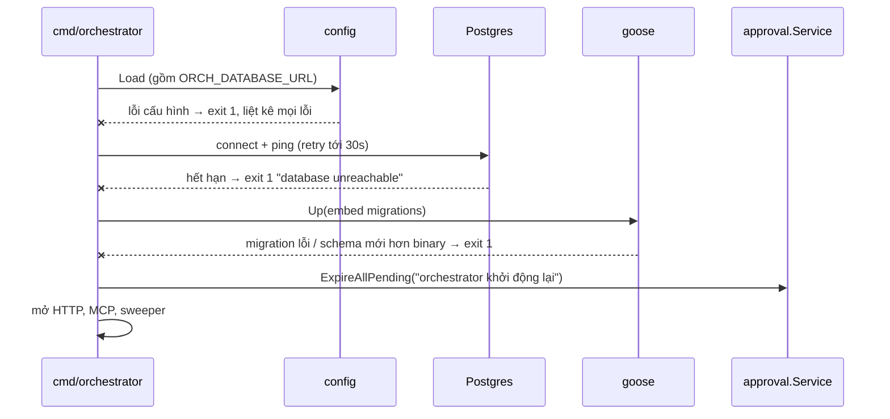

# Design — storage

Một adapter `internal/adapter/repository/postgres` giữ `pgxpool.Pool`, implement `TxRunner` bằng cách gắn `pgx.Tx` vào context; mọi repository lấy executor từ context (tx nếu có, pool nếu không). Migration là file SQL goose embed, chạy trong `cmd/orchestrator` trước khi mở cổng.

## Constraints

| # | Constraint | How it is checked |
|---|---|---|
| 1 | Use case chỉ thấy `port.TxRunner` và repository port, không import pgx | depguard rule `usecase` |
| 2 | Config DB inject vào adapter từ `cmd/orchestrator`, không đọc env trong adapter | review |
| 3 | `Update` dùng `FOR UPDATE` (R-10) | `TestConcurrentDecisionsOnlyOneWins` chạy với Postgres (integration) |
| 4 | Không log DSN (SEC-1) | test `TestConfigRedactsDatabaseURL` |
| 5 | Migration forward-only, không sửa file đã merge | review; goose `-allow-missing=false` |

## Components

| Path | Component | Responsibility | Status |
|---|---|---|---|
| `compose.yaml`, `.env.example` | Postgres local | R-1, R-2 | new |
| `Makefile` | `db-up`, `db-down`, `db-psql`, `test-integration` | R-3 | modified |
| `internal/platform/config` | `Database` config | đọc, validate, redact | modified |
| `migrations/` + `migrations/embed.go` | SQL goose | schema; `00001_approvals.sql` | new |
| `internal/usecase/port` | `TxRunner` | port | new |
| `internal/adapter/repository/postgres/db.go` | `Open`, `TxRunner`, `executor(ctx)`, retry 40001/40P01 | pool, transaction | new |
| `internal/adapter/repository/postgres/approval.go` | `ApprovalRepository` | thay bản in-memory | new |
| `internal/adapter/repository/memory` | in-memory repository | chỉ còn dùng làm fake trong test | modified |
| `internal/delivery/httpapi/health.go` | `/readyz` | ping DB 2s | new |
| `cmd/orchestrator/main.go` | wiring | kết nối, migrate, expire approval cũ, shutdown order | modified |

## Flows

### Khởi động

Step 1 — Load config (`internal/platform/config`)
- Trigger: process start.
- Pre-condition: none.
- Call: đọc env, validate cùng các biến khác.
    - Success → bước 2.
    - Failure (thiếu `ORCH_DATABASE_URL`) → exit 1. Signal: log ERROR `invalid config` + danh sách tên biến lỗi.
    - Failure (`ORCH_DB_MAX_CONNS` ngoài 1…50) → exit 1. Signal: như trên.
    - Grouped with: none.

Step 2 — Kết nối (`postgres.Open`)
- Trigger: bước 1.
- Pre-condition: config hợp lệ.
- Call: `pgxpool.New` + `Ping`, retry mỗi 1s tới `ORCH_DB_CONNECT_TIMEOUT`.
    - Success → bước 3.
    - Failure (hết hạn) → exit 1. Signal: log ERROR `database unreachable` + `host`, `port`, `db`.
    - Grouped with: none.

Step 3 — Migrate (goose)
- Trigger: bước 2.
- Pre-condition: kết nối sống.
- Call: `goose.Up` với `embed.FS`; goose giữ advisory lock nên hai process không chạy chồng.
    - Success → log INFO `schema migrated` + `version`, bước 4.
    - Failure (lỗi SQL) → migration đó rollback (goose chạy mỗi file trong tx), exit 1. Signal: log ERROR `migration failed` + `version`.
    - Failure (DB version > binary version) → exit 1 (R-7). Signal: log ERROR `schema newer than binary` + hai version.
    - Grouped with: mỗi file migration một transaction.

Step 4 — Dọn approval treo (`approval.Service`)
- Trigger: bước 3.
- Pre-condition: none.
- Call: `ExpireAllPending(reason)` một câu `UPDATE … WHERE status = 'pending'` + durable event `approval.expired` cho từng bản ghi trong cùng tx.
    - Success → bước 5.
    - Failure (lỗi DB) → exit 1. Signal: log ERROR `expire pending on start failed`.
    - Grouped with: một transaction.

Step 5 — Mở cổng (`cmd/orchestrator`)
- Trigger: bước 4.
- Call: HTTP, MCP, sweeper, supervisor.
    - Success → `/readyz` 200.
    - Grouped with: none.

### Transaction

`TxRunner.WithinTx(ctx, fn)`: nếu ctx đã có tx thì chạy `fn` trong tx đó (không lồng). Ngược lại `pool.BeginTx(ReadCommitted)` → `fn(ctxWithTx)` → commit; lỗi hoặc panic → rollback (panic được re-panic sau rollback). SQLSTATE `40001`/`40P01` → chạy lại cả `fn` tối đa 3 lần (R-11); `fn` phải idempotent trong phạm vi transaction (không side effect ngoài DB, không publish event bên trong).

### Update atomic

`Update(ctx, id, mutate)` = `WithinTx`: `SELECT … FROM <table> WHERE id = $1 FOR UPDATE` → `ErrNotFound` nếu không có dòng → `mutate(&entity)` → lỗi thì rollback, trả lỗi → `UPDATE … SET … WHERE id = $1` → commit.

## Persistence

`00001_approvals.sql`:

| Column | Type | Notes |
|---|---|---|
| `id` | `uuid` PK | |
| `agent_id` | `text` | sẽ thành `uuid` FK khi agent-registry có bảng `agents` (migration của agent-registry) |
| `kind`, `tool_name`, `risk`, `status` | `text` | CHECK theo giá trị của domain |
| `input` | `jsonb` | không log (approval-inbox SEC-1) |
| `created_at`, `deadline`, `decided_at` | `timestamptz` | index `(status, deadline)` |
| `decided_by`, `reason` | `text` null | |

Quy ước cho mọi bảng: PK `uuid` do `IDGenerator` sinh (UUIDv4 hiện có), thời gian `timestamptz` UTC, enum là `text` + CHECK, không xoá cứng bản ghi nghiệp vụ.

## Config and lifecycle

| Name | Required | Default | Validated |
|---|---|---|---|
| `ORCH_DATABASE_URL` | yes | — | parse được bằng `pgxpool.ParseConfig` |
| `ORCH_DB_MAX_CONNS` | no | 10 | 1…50 |
| `ORCH_DB_CONNECT_TIMEOUT` | no | 30s | 1s…5m |

Shutdown: dừng HTTP → MCP → supervisor → sweeper → đóng pool (R-12).

## Error mapping

| Source error | Code | Result | Message key |
|---|---|---|---|
| không có dòng (`pgx.ErrNoRows`) | `not_found` | `domain.ErrNotFound` | theo feature |
| unique violation `23505` | `already_exists` | `domain.ErrAlreadyExists` | theo feature |
| check / FK violation `23514`, `23503` | `internal` | 500 opaque, log ERROR với constraint name (lỗi lập trình) | `common.internal` |
| hết retry `40001`/`40P01` | `internal` | 500 opaque | `common.internal` |
| ping lỗi | — | `/readyz` 503 | — |

## Test plan

| Test | Proves | Level | Location |
|---|---|---|---|
| `docker compose config` + `make db-up` + `pg_isready` | R-1, R-3, SEC-2 | C | thủ công |
| `git check-ignore .env` | R-2 | A | CI / thủ công |
| `TestLoadDatabaseConfig`, `TestConfigRedactsDatabaseURL` | R-4, SEC-1 | B | `internal/platform/config` |
| `TestOpenTimeout` | R-5 | B (integration) | `internal/adapter/repository/postgres` |
| `TestMigrateUpAndRefuseNewerSchema` | R-6, R-7 | B (integration) | như trên |
| `TestReadyz` | R-8 | B | `internal/delivery/httpapi` |
| `TestWithinTxCommitRollbackPanic` | R-9 | B (integration) | `postgres/db_test.go` |
| `TestConcurrentDecisionsOnlyOneWins` (Postgres) | R-10, R-13 | B (integration, `-race`) | `postgres/approval_test.go` |
| `TestRetryOnSerializationFailure` | R-11 | B (integration) | `postgres/db_test.go` |
| tắt orchestrator bằng SIGTERM, log thứ tự shutdown | R-12 | C | thủ công |
| `TestApprovalRepositoryContract` chạy chung cho memory và Postgres | R-13 | B | `internal/adapter/repository/...` |
| `TestExpirePendingOnStart` | R-14 | B (integration) | `postgres/approval_test.go` |

Not automated: SEC-3 kiểm bằng review (không có `fmt.Sprintf` trong SQL); SEC-4 là giả định về máy owner.

## Deliberately stubbed

- Không backup volume: TD-1.
- Ứng dụng dùng user superuser do image tạo: TD-2.
