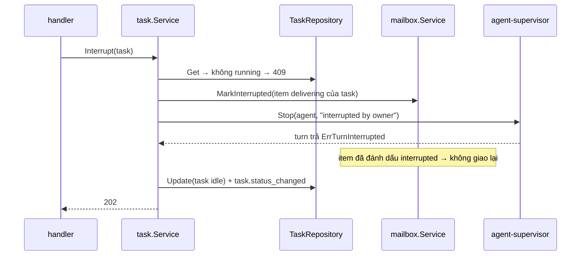
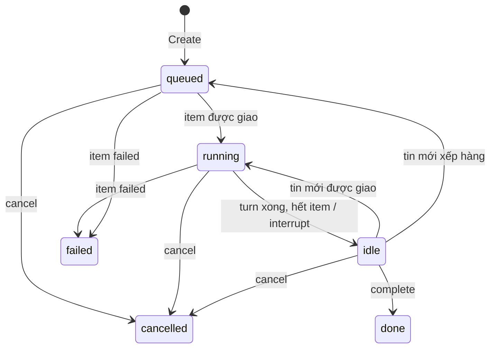

# Design — task-dispatch

`domain.Task` giữ state machine. Use case `task.Service` điều phối workspace, mailbox, supervisor; một subscriber nội bộ nghe event `mailbox.*` của item có `task_id` để cập nhật trạng thái task (R-5…R-7), trong transaction riêng.

## Constraints

| # | Constraint | How it is checked |
|---|---|---|
| 1 | State machine trong domain | depguard; test bảng |
| 2 | Task và item mailbox đầu tiên lưu cùng transaction | `TestCreateTaskAtomic` (integration) |
| 3 | Gọi feature khác qua port | depguard `usecase` |
| 4 | Không log prompt (SEC-1) | review |

## Components

| Path | Component | Responsibility | Status |
|---|---|---|---|
| `internal/domain/task.go` | `Task`, `TaskStatus`, chuyển trạng thái, `Validate` | rule | new |
| `internal/usecase/port` | `TaskRepository`, `WorktreeCreator`, `MailboxWriter`, `TurnStopper` | port | new |
| `internal/usecase/task/service.go` | `Create`, `SendMessage`, `Interrupt`, `Cancel`, `Complete`, `List`, `Get` | điều phối | new |
| `internal/usecase/task/projector.go` | nghe `mailbox.delivered/done/failed` → cập nhật task | R-5…R-7 | new |
| `internal/adapter/repository/postgres/task.go` | repository | bảng `tasks` | new |
| `internal/delivery/httpapi/tasks.go` | handlers | | new |

## Flows

### Tạo task

```mermaid
sequenceDiagram
    participant H as handler
    participant S as task.Service
    participant R as TaskRepository
    participant W as workspace.Service
    participant M as mailbox.Service
    participant E as EventStore
    H->>S: Create(req, idemKey)
    S->>R: FindByIdempotency(idemKey)
    R-->>S: có → trả task cũ (200)
    S->>S: validate; project ready; agent active/paused; parent tồn tại
    S--xH: 400 / 409
    S->>W: CreateWorktree(project, agent.slug, title, taskID)
    W--xH: ErrProjectNotReady / ErrGit → 409 / 502
    rect rgb(240,240,240)
    Note over S,E: một transaction
    S->>R: Create(task queued, worktree)
    S->>M: Enqueue(kind task, task_id, body = prompt)
    M--xS: mailbox_full → rollback, 409
    S->>E: Append(task.created)
    end
    S-->>H: 201 task
```

Step 1 — Idempotency (`task.Service`)
- Trigger: `POST /tasks`.
- Call: `FindByIdempotency` khi có header.
    - Success (có) → 200 task cũ, dừng.
    - Grouped with: unique index `tasks(idempotency_key)`; vi phạm ở bước 4 → đọc lại, trả task cũ.

Step 2 — Validate (`domain.Task`, repo)
- Call: field, project `ready`, agent `active`/`paused`, `parent_id`.
    - Success → bước 3.
    - Failure (field) → 400. Signal: none.
    - Failure (project chưa ready) → 409 `project_not_ready`. Signal: none.
    - Failure (agent archived / không có) → 409 `agent_unavailable` / 404. Signal: none.
    - Grouped with: none.

Step 3 — Worktree (other feature: [workspace](../workspace/design.md#tạo-worktree-cho-task))
- Call: `CreateWorktree` với `taskID` đã sinh trước.
    - Success → bước 4.
    - Failure → trả lỗi của workspace, không lưu task. Signal: workspace log.
    - Grouped with: none (thao tác đĩa, không rollback được, R-4).

Step 4 — Lưu và đưa vào mailbox (`TaskRepository`, `mailbox.Service`)
- Call: trong tx: `Create(task)`, `Enqueue(task item)`, `Append(task.created)`.
    - Success → commit, publish, 201.
    - Failure (mailbox đầy) → rollback, 409 `mailbox_full`; worktree còn lại. Signal: log WARN `task create rolled back` + `task_id`, `worktree`.
    - Failure (DB lỗi) → rollback, 500. Signal: log ERROR như trên.
    - Grouped with: một transaction.

### Interrupt



Step 1 — Đánh dấu item (other feature: [agent-mailbox](../agent-mailbox/design.md))
- Call: `MarkInterrupted(item)` (agent-mailbox R-21) đặt cờ để `Interrupt` của scheduler chuyển item sang `done` (ghi chú `interrupted`) thay vì `queued`.
    - Success → bước 2.
    - Failure (không còn item `delivering`: turn vừa xong) → 409 `not_running`. Signal: none.
    - Grouped with: một transaction.

Step 2 — Dừng (other feature: [agent-supervisor](../agent-supervisor/design.md#dừng))
- Call: `Stop(agent, reason)`, chờ tối đa 5s.
    - Success → bước 3.
    - Failure (không dừng được) → agent `failed`; task vẫn chuyển `idle`. Signal: log ERROR từ supervisor.
    - Grouped with: none.

Step 3 — Task `idle` (`TaskRepository`)
- Call: `Update(task, idle)` + event.
    - Success → 202.
    - Grouped with: một transaction.

### Cancel

Như Interrupt nhưng: `mailbox.CancelQueued(task)` trong cùng transaction với `task → cancelled`; Stop chỉ gọi khi `running`. Worktree giữ nguyên.

### Projector

`mailbox.delivered{task_id}` → task `running`; `mailbox.done{task_id}` → nếu không còn item mở của task: `idle`, cộng chi phí (lấy từ `turn.completed` cùng `delivery_id`); `mailbox.failed{task_id}` → `failed`. Mỗi event một `Update` atomic; task đã `cancelled`/`done` thì bỏ qua. Projector chạy trong process, đọc event sau commit; khởi động lại thì đối chiếu task `running` với mailbox (không còn item mở → `idle`).

## State machine



| State | Allowed actions | Limits | Exit |
|---|---|---|---|
| `queued` | messages, cancel | — | `running`, `cancelled`, `failed` |
| `running` | messages, interrupt, cancel | `ORCH_TURN_TIMEOUT` (supervisor) | `idle`, `cancelled`, `failed` |
| `idle` | messages, cancel, complete | — | `queued`, `running`, `done`, `cancelled` |
| `done`, `cancelled`, `failed` | GET | terminal | — |

## Error mapping

| Source error | Code | Result | Message key |
|---|---|---|---|
| `domain.ErrInvalidArgument` | `invalid_argument` | 400 | `task.invalid` |
| `domain.ErrNotFound` | `not_found` | 404 | `task.not_found` |
| `workspace.ErrProjectNotReady` | `project_not_ready` | 409 | `project.not_ready` |
| agent archived | `agent_unavailable` | 409 | `task.agent_unavailable` |
| `mailbox.ErrMailboxFull` | `mailbox_full` | 409 | `mailbox.full` |
| `task.ErrTaskClosed` | `task_closed` | 409 | `task.closed` |
| `task.ErrNotRunning` | `not_running` | 409 | `task.not_running` |
| `domain.ErrInvalidState` | `invalid_state` | 409 | `task.invalid_state` |
| `workspace.ErrGit` | `git_failed` | 502 | `worktree.git_failed` |
| khác | `internal` | 500 opaque | `common.internal` |

## Persistence

`tasks(id uuid PK, project_id FK, agent_id FK, parent_id uuid null FK, title text, prompt text, status text CHECK, reason text, worktree_id FK, cost_usd numeric(12,6), num_turns int, last_result_preview text, idempotency_key text UNIQUE null, created_at, updated_at)`. Index `(agent_id, created_at desc)`, `(status)`.

## Test plan

| Test | Proves | Level | Location |
|---|---|---|---|
| `TestCreateTaskAtomic` | R-1 | B (integration) | `postgres/task_test.go` |
| `TestCreateTaskIdempotent` | R-2 | B | use case |
| `TestCreateTaskValidation` | R-3 | B | use case + domain |
| `TestCreateTaskMailboxFullKeepsWorktree` | R-4 | B | use case với fake workspace |
| `TestProjectorRunningIdleFailed` | R-5, R-6, R-7 | B | `task/projector_test.go` |
| `TestSendMessage` | R-8 | B | use case |
| `TestInterruptResumesSameSession` | R-9 | B | use case; (D) máy owner |
| `TestCancelCancelsQueued` | R-10 | B | use case |
| `TestComplete` | R-11 | B | use case |
| `TestTaskEndpoints` | R-12 | B | `httpapi` |
| curl `-N /events?task_id=` khi chạy task thật | R-13 | C/D | thủ công |
