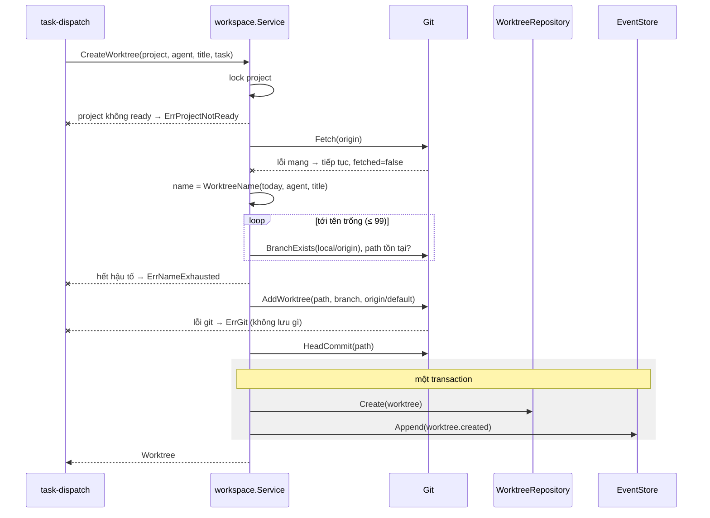
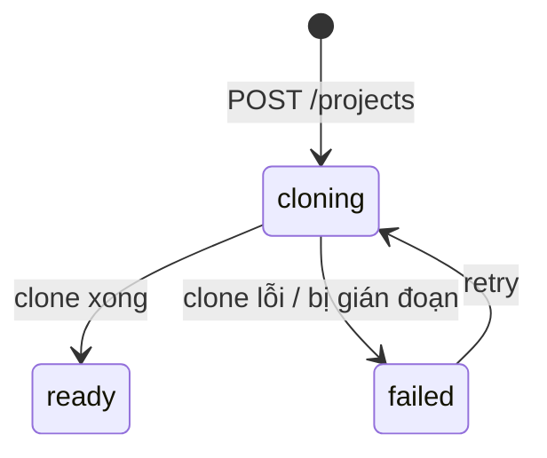

# Design — workspace

Rule đặt tên (ngày, slug, hậu tố) là domain thuần. Use case `workspace.Service` khoá theo project, gọi `port.Git` và lưu bản ghi. Adapter `gitcli` chạy `git` bằng argv với env cố định.

## Constraints

| # | Constraint | How it is checked |
|---|---|---|
| 1 | Đặt tên thuần, test bảng | depguard `domain`; `TestWorktreeName` |
| 2 | Không shell, env cố định (SEC-1) | review; `TestGitEnv` |
| 3 | Thao tác ghi tuần tự theo project (R-9) | mutex theo project id; `TestConcurrentWorktreesSameProject` (`-race`) |
| 4 | Không có code xoá worktree/branch (R-11) | review |

## Components

| Path | Component | Responsibility | Status |
|---|---|---|---|
| `internal/domain/workspace.go` | `Project`, `Worktree`, `WorktreeName(date, agent, title)`, `NextFreeName`, `ValidateRepoURL` | rule | new |
| `internal/usecase/port` | `Git`, `ProjectRepository`, `WorktreeRepository`, `FileSystem` | port | new |
| `internal/usecase/workspace/service.go` | `CreateProject`, `Retry`, `CreateWorktree`, `List…` | điều phối, khoá theo project, event | new |
| `internal/adapter/gitcli` | `Git` | `exec.Command("git", …)`, env cố định, timeout | new |
| `internal/adapter/repository/postgres/workspace.go` | repo | bảng `projects`, `worktrees` | new |
| `internal/delivery/httpapi/projects.go` | handlers | | new |
| `internal/platform/config` | `ORCH_WORKSPACE_ROOT` | đọc, mở rộng `~`, kiểm | modified |

## Flows

### Tạo worktree cho task

Step 1 — Khoá và kiểm (`workspace.Service`)
- Trigger: task-dispatch tạo task.
- Pre-condition: project tồn tại.
- Call: lock mutex của project; kiểm `status = ready`.
    - Success → bước 2.
    - Failure (không `ready`) → `ErrProjectNotReady`. Signal: none: caller nhận 409.
    - Grouped with: lock tới hết bước 5.

Step 2 — Fetch (`Git`)
- Call: `git -C repo fetch --prune origin`, timeout 60s.
    - Success → bước 3.
    - Failure (mạng, auth) → tiếp tục với ref local, `fetched = false` (R-8). Signal: log WARN `git fetch failed` + `project_id`.
    - Grouped with: none.

Step 3 — Đặt tên (`domain.WorktreeName`, `Git.BranchExists`)
- Call: tên gốc từ ngày local + agent slug + task slug; thử hậu tố tới khi thư mục, branch local và `origin/<name>` đều chưa có.
    - Success → bước 4.
    - Failure (đã tới `-99`) → `ErrNameExhausted`. Signal: log ERROR `worktree name exhausted` + `project_id`, tên gốc.
    - Grouped with: none.

Step 4 — Tạo worktree (`Git`)
- Call: `git -C repo worktree add -b <name> <path> origin/<default_branch>`, timeout 120s.
    - Success → bước 5.
    - Failure (lỗi git) → `ErrGit`; thư mục dở được git tự dọn, không lưu DB. Signal: log ERROR `git worktree add failed` + `project_id`, exit code, dòng lỗi đầu đã lọc.
    - Grouped with: none.

Step 5 — Lưu (`WorktreeRepository`, `EventStore`)
- Call: `HeadCommit`, rồi `Create` + `Append(worktree.created{name, path, branch, base_commit, fetched})`.
    - Success → trả `Worktree`.
    - Failure (DB lỗi) → trả lỗi; worktree đã tạo trên đĩa nhưng không có bản ghi; lần tạo sau sẽ thấy tên đã dùng và thêm hậu tố. Signal: log ERROR `worktree record failed` + `path`.
    - Grouped with: một transaction cho bản ghi + event.

### Clone project

`POST /projects → ValidateRepoURL → Create(project, cloning) + event → goroutine nền: lock project → git clone --origin origin <url> <root>/<slug>/repo (timeout 10m) → DefaultBranch (symbolic-ref origin/HEAD) → Update(ready | failed, reason) + event`. Orchestrator dừng giữa chừng: lúc khởi động project `cloning` chuyển `failed` với reason "bị gián đoạn" để owner retry.

## State machine

| State | Allowed actions | Limits | Exit |
|---|---|---|---|
| `cloning` | GET | 10m | `ready`, `failed` |
| `ready` | CreateWorktree, GET | — | — |
| `failed` | Retry, GET | — | `cloning` |

## Error mapping

| Source error | Code | Result | Message key |
|---|---|---|---|
| `domain.ErrInvalidArgument` (URL, slug) | `invalid_argument` | 400 | `project.invalid` |
| slug trùng | `slug_taken` | 409 | `project.slug_taken` |
| `ErrProjectNotReady` | `project_not_ready` | 409 | `project.not_ready` |
| `ErrNameExhausted` | `worktree_name_exhausted` | 409 | `worktree.name_exhausted` |
| `ErrGit` | `git_failed` | 502 với dòng lỗi đã lọc | `worktree.git_failed` |
| `domain.ErrNotFound` | `not_found` | 404 | `project.not_found` |
| khác | `internal` | 500 opaque | `common.internal` |

## Persistence

`projects(id uuid PK, slug text UNIQUE, repo_url text, default_branch text, status text CHECK, reason text, created_at, updated_at)`. `worktrees(id uuid PK, project_id FK, task_id uuid UNIQUE, agent_id FK, name text, path text UNIQUE, branch text, base_commit text, created_at)`.

## Config

`ORCH_WORKSPACE_ROOT`: mở rộng `~`, tuyệt đối hoá, `MkdirAll 0700`, kiểm `git -C <root> rev-parse` phải lỗi (không nằm trong repo), kiểm ghi được bằng file tạm.

## Test plan

| Test | Proves | Level | Location |
|---|---|---|---|
| `TestWorkspaceRootValidation` | R-1 | B | `internal/platform/config` |
| `TestCreateProjectClones`, `TestCloneFailureRecorded` | R-2 | B | use case + fake `Git`; (C) clone repo thật |
| `TestValidateRepoURL` | R-3, SEC-2 | B | `internal/domain/workspace_test.go` |
| `TestRetryProject` | R-4 | B | use case |
| clone repo private bằng SSH agent của owner | R-5 | D | máy owner |
| `TestWorktreeName` (bỏ dấu tiếng Việt, cắt 30, rỗng) | R-6 | B | domain |
| `TestNextFreeName` | R-7 | B | domain + use case |
| `TestFetchFailureStillCreates` | R-8 | B | use case |
| `TestConcurrentWorktreesSameProject` | R-9 | B (`-race`) | use case |
| `TestWorktreeRecordedWithEvent` | R-10 | B | use case |
| review: không có `worktree remove`, `branch -D` trong code | R-11, R-12 | A | grep trong CI |
| `TestListWorktrees` | R-13 | B | `httpapi` |
| `TestGitEnv` | SEC-1, SEC-3 | B | `adapter/gitcli` |
| tạo 2 task cùng project cùng lúc trên repo thật | R-6…R-10 | C | `make run` + curl |
